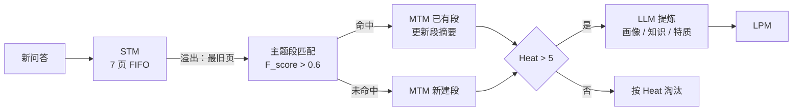
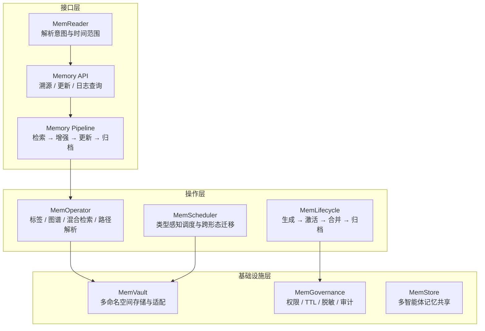
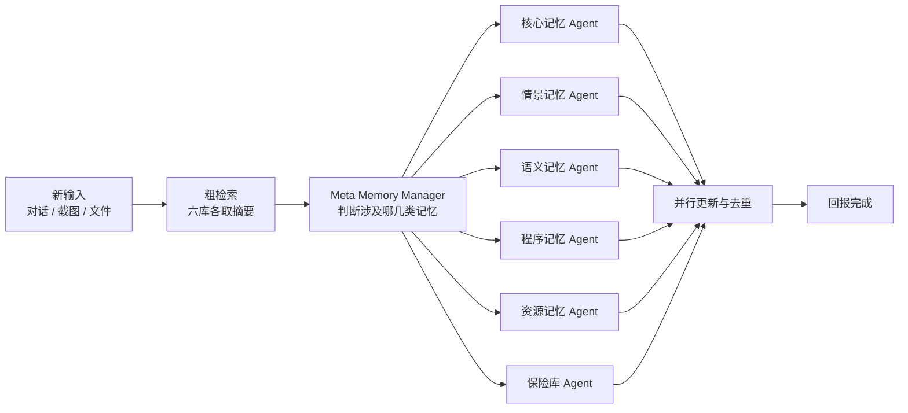

# 七大记忆与上下文架构精读：分级交换、事实抽取、多智能体分库与记忆形态

## 0 统一分析框架

七套系统面对同一个物理约束：上下文窗口有限，而对话轮次、工具输出和单条命令日志持续增长。把全部历史拼进提示词，成本随轮数线性上升，且长上下文后段的注意力利用率下降；只保留定长窗口，窗口外的信息则彻底丢失。两者的失效方式不同，但都在同一个位置暴露——注入到模型的那一段文本。

按五个维度切开，七套方案的取舍就能对齐比较：

| 维度       | 关注点                                                     | 暴露的工程问题                           |
|:---------- |:---------------------------------------------------------- |:---------------------------------------- |
| 记忆形态   | 记忆以什么物理形式存在：文本、向量、分页块、KV cache、权重 | 写入成本、读取延迟、可编辑性三者不可兼得 |
| 记忆载体   | 存在哪里：内存结构、关系库、图上、本地文件                 | 是否可审计、可回滚、可迁移               |
| 写入单位   | 一条记忆的粒度：对话页、主题段、原子事实、三元组、文件段落 | 粒度越细，更新越准，抽取成本越高         |
| 组织与淘汰 | 靠什么决定保留与丢弃：热度、保留率、冲突覆盖、容量上限     | 决定长期运行后的记忆质量                 |
| 注入方式   | 查询时如何拼进上下文：全量、Top-k、两阶段、按需读文件      | 直接决定 Token 成本与 P95 延迟           |

**记忆形态谱系。** 七套系统实际只用到五种形态，越往下写入越贵、读取越快：

| 形态     | 典型载体                     | 写入成本          | 读取延迟          | 可编辑性   | 可解释性 | 代表系统                       |
|:-------- |:---------------------------- |:----------------- |:----------------- |:---------- |:-------- |:------------------------------ |
| 明文     | 文本、图谱、Markdown 文件    | 低                | 中（检索 + 注入） | 直接可改   | 高       | MemoryBank、Claude Code、Codex |
| 向量条目 | 嵌入 + 元数据                | 中（抽取 + 编码） | 低                | 需整条重写 | 中       | Mem0、MemoryOS 中期记忆        |
| 分页块   | 页、段等结构化块             | 低                | 低（按热度调度）  | 可重组     | 中       | MemoryOS                       |
| 激活态   | KV cache、隐状态、注意力权重 | 高（需前向计算）  | 极低              | 难         | 低       | MemOS                          |
| 参数态   | 权重、LoRA、适配器           | 极高（需训练）    | 零（已内化）      | 难         | 低       | MemOS                          |

**术语约定。** 为避免同名异义，全文按下列含义使用：

| 术语                   | 英文                                      | 含义                                                        |
|:---------------------- |:----------------------------------------- |:----------------------------------------------------------- |
| 短期工作记忆           | Short-Term Memory, STM                    | 当前会话最近若干轮的原始对话，容量固定                      |
| 中期记忆               | Mid-Term Memory, MTM                      | 按主题聚合的对话段，容量远大于 STM                          |
| 长期个人记忆           | Long-Term Personal Memory, LPM            | 用户画像、知识库与智能体特征等稳定事实                      |
| 原子事实               | Atomic Fact                               | 脱离原对话仍可独立理解的一条最小事实陈述                    |
| 热度                   | Heat                                      | 由访问次数、段内页数与时间新鲜度合成的保留优先级            |
| 保留率                 | Retention                                 | 记忆随时间衰减后仍可被检索到的概率                          |
| 记忆立方               | MemCube                                   | MemOS 的统一记忆单元：内容载荷 + 标识、治理、行为三类元数据 |
| 明文 / 激活 / 参数记忆 | Plaintext / Activation / Parameter Memory | 三种记忆形态：外部文本、推理时 KV 状态、模型权重            |
| 溯源超图               | Provenance Hypergraph                     | MIRIX-2.0 用 n 元事实帧索引情景与语义记录，并回指原始行     |
| 前缀缓存               | Prompt Cache                              | 服务端对相同前缀复用 KV 计算，命中后显著降低延迟与成本      |

参数标注分三类：〔论文〕为论文正文给出的设定，〔实现〕为开源仓库或产品默认值，〔实践〕为工程复现中的常见做法。三类数值不可混用，混用会让同一段结论在不同版本下自相矛盾。

---

## 1 MemoryOS：用分页与热度置换管理三级记忆

北京邮电大学与腾讯 AI Lab，EMNLP 2025 Oral，arXiv:2506.06326。

### 1.1 问题与约束

长对话的记忆系统要同时满足三件事：近期上下文不能丢、历史话题要能按主题找回、用户与智能体的稳定属性要能沉淀。单一向量库混存做不到第三点——画像类信息与对话片段混在同一索引里，检索时互相挤压；也做不到第二点——按句子切片后，同一话题的上下文被切碎，召回若干互不相邻的片段，模型仍需重新拼接。

MemoryOS 的做法是把操作系统的分段分页与页面置换搬进来：容量固定、层级明确、迁移由确定性规则触发，大模型只负责摘要、话题判定与事实提炼，不参与"该不该换页"的决策。

### 1.2 三级结构与写入路径

- **STM**：容量 7 页的先进先出队列〔论文〕。每页记为 $page_i = \{Q_i, R_i, T_i, meta^{chain}_i\}$，即查询、回复、时间戳，外加一条对话链元信息。元信息由模型分两步生成：先判断新页与前序页是否语义连续，连续则接入当前链，不连续则以本页重开一条链；再把链上所有页汇总为 $meta^{chain}_i$。检索时 7 页全部注入，不做筛选。
- **MTM**：按主题聚合的段（Segment），段内保存原始页，段本身维护一份由模型生成的摘要。容量在论文中设为 200 段〔论文〕，开源实现 `mid_term_capacity` 默认 2000〔实现〕。
- **LPM**：分用户侧与智能体侧〔论文〕。
  - 用户侧：静态档案（性别、姓名、出生年份等固定属性）、用户知识库（User KB，从交互中增量抽取的事实）、用户特质（User Traits，沿用 Li et al. 2025 的 90 维设定，分基础需求与性格、AI 对齐维度、内容平台兴趣标签三类）。
  - 智能体侧：智能体档案（角色设定等固定项）与智能体特征（Agent Traits，交互中新增的设定、推荐过的条目等）。
  - User KB 与 Agent Traits 各为容量 100 的先进先出队列。

### 1.3 归并判据

一页写入 MTM 时，与各段逐一比对，取匹配分最高者：

$$
F_{\text{score}} = \cos(\mathbf{e}_s, \mathbf{e}_p) + \mathrm{Jaccard}(K_s, K_p)
$$

符号解释如下：

1. $\mathbf{e}_s$、$\mathbf{e}_p$：段摘要与页文本的嵌入向量，默认编码器为 `BAAI/bge-m3`〔实现〕。
2. $K_s$、$K_p$：由模型从段与页中抽取的关键词集合。
3. $\cos(\cdot)$：余弦相似度，捕捉语义相近；归一化嵌入下文本对的取值实际落在 $[0,1]$。
4. $\mathrm{Jaccard}(\cdot)$：关键词交集与并集之比，取值 $[0,1]$，捕捉用词相同。

两项相加，满分 2.0；匹配分**超过**阈值 $\theta = 0.6$ 的页并入该段，否则新建段〔论文〕。论文只给出取值，未说明依据。从量纲看，0.6 相对满分 2.0 是偏宽松的门槛：口语对话中模型抽出的关键词集合通常很小、措辞多变，Jaccard 项往往只贡献零点几，归并与否主要由余弦项决定；一旦两侧关键词命中同一核心实体，Jaccard 项会额外抬高分数，使"说法不同但指向同一对象"的页更容易归入同段。设阈值而非直接取最大值，是为了在没有足够相近的段时开新段，避免不同话题被强行并入同一摘要。

> [!IMPORTANT] 双信号相加的作用
> 稠密向量对"意思相近、说法不同"敏感，但对专有名词、编号、错误码不敏感；Jaccard 恰好相反。单用任一信号都会在某一类对话上系统性误判，相加是在两种失效模式之间取折中。

### 1.4 热度、置换与晋升

$$
\text{Heat} = \alpha N_{\text{visit}} + \beta L_{\text{interaction}} + \gamma R_{\text{recency}},
\qquad R_{\text{recency}} = \exp\left(-\frac{\Delta t}{\mu}\right)
$$

符号解释如下：

1. $N_{\text{visit}}$：该段被检索命中的累计次数。
2. $L_{\text{interaction}}$：段内保存的对话页数量。
3. $R_{\text{recency}}$：时间新鲜度，按距上次访问的时间 $\Delta t$ 指数衰减。
4. $\mu$：衰减时间常数，论文取 $10^{7}$ 秒〔论文〕，折合 115.7 天；对应半衰期 80.2 天。
5. $\alpha,\beta,\gamma$：三项权重，论文均取 1。

代入 $\mu$ 可得新鲜度的实际曲线：闲置 30 天为 0.77，90 天为 0.46，180 天为 0.21。也就是说，跨月未访问的话题仍保有近半权重，只有半年量级的沉寂才会让新鲜度退出竞争——这与"几周内活跃话题不该被淘汰"的设计意图一致。

两条规则由热度驱动：

- MTM 满载时淘汰热度最低的段，冷门话题因此让位给新话题。
- 某段热度越过晋升阈值 $\tau = 5$〔论文〕时，调用模型从该段提炼用户事实与智能体特征写入 LPM；随后该段的页数计数清零，热度随之跌落，避免同一批内容被反复提炼、画像被重复覆盖。

示例计算：某段 4 页、被命中 2 次、新鲜度 0.8，则 $\text{Heat} = 4 + 2 + 0.8 = 6.8$，越过阈值触发晋升。由于三项等权且页数直接入账，页数越多的段越容易晋升，长话题会先于短话题沉淀进 LPM——这是该公式的隐含偏好，工程上若要抑制，可对 $L_{\text{interaction}}$ 取对数或设上限。

> [!WARNING] 主题段容量的两个数字
> 论文正文给出的 MTM 容量是 200 段，开源仓库 `mid_term_capacity` 默认 2000。二者不是版本迭代关系，而是论文设定与工程默认值的差别。引用"2000 段"时必须注明来源为实现默认值，否则与论文对不上。

### 1.5 检索组装

新查询到来时三路并行读取，再拼成一次提示：

| 来源 | 召回量                                                                 | 说明                                                                    |
|:---- |:---------------------------------------------------------------------- |:----------------------------------------------------------------------- |
| STM  | 全部 7 页                                                              | 保证最近语境完整，不做相关性筛选                                        |
| LPM  | User KB、Agent Traits 各取语义最相关的 Top-10；三份档案与用户特质全量注入 | 档案与特质是稳定画像，不参与相似度竞争；事实类条目才按相关性截取        |
| MTM  | 按 $F_{\text{score}}$ 粗筛 Top-$m$ 段（$m=5$），再按语义相似度段内取 Top-$k$ 页 | 两阶段把 $O(\text{段数} \times \text{页数})$ 的比较压缩为两级小规模排序 |

$k$ 在 GVD 上取 5，在 LoCoMo（平均约 300 轮、9K tokens）上取 10〔论文〕。粗筛到精排的两级结构是关键：直接在全部页上做语义排序，候选规模随对话长度线性膨胀；先按段摘要定位话题，再在段内比较具体页，比较次数被压到两级各自的小常数。

检索完成后，被选中段的 $N_{\text{visit}}$ 加一、$R_{\text{recency}}$ 刷新〔论文〕。这一步把检索与热度连成闭环：被反复问到的话题热度上升，更快晋升到 LPM，也更不容易被淘汰。

### 1.6 实验结果

评测在 GVD（15 个虚拟用户、10 天、每天至少两个话题，即 MemoryBank 构建的数据）与 LoCoMo 上进行，基线为 TiM、MemoryBank、MemGPT、A-Mem〔论文〕。

**LoCoMo（GPT-4o-mini，F1）：**

| 方法       | 单跳  | 多跳  | 时间推理 | 开放域 |
|:---------- |:----- |:----- |:-------- |:------ |
| MemoryBank | 5.00  | 9.68  | 5.56     | 6.61   |
| TiM        | 16.25 | 18.43 | 8.35     | 23.74  |
| MemGPT     | 26.65 | 25.52 | 9.15     | 41.04  |
| A-Mem*（同环境复现） | 22.61 | 33.23 | 8.04 | 34.13 |
| MemoryOS   | 35.27 | 41.15 | 20.02    | 48.62  |

相对最强基线，F1 平均提升 49.11%、BLEU-1 平均提升 46.18%；提升最大的是时间推理（F1 +118.80%），因为对话链与段内保序页保留了事件先后关系。多跳仅 +23.83%（F1）、+5.67%（BLEU-1），段级检索对"跨话题拼接"的帮助有限。换到 Qwen2.5-3B，各项仍排第一。GVD 上相对 A-Mem 的检索准确率提升 3.2%（93.3 对 90.4），差距远小于 LoCoMo——短对话里各方法都接近天花板。

**效率（LoCoMo，单次回答）：**

| 方法       | 召回 Token | LLM 调用次数 | 平均 F1 |
|:---------- |:---------- |:------------ |:------- |
| MemoryBank | 432        | 3.0          | 6.84    |
| TiM        | 1,274      | 2.6          | 18.01   |
| A-Mem*     | 2,712      | 13.0         | 26.55   |
| MemGPT     | 16,977     | 4.3          | 29.13   |
| MemoryOS   | 3,874      | 4.9          | 36.23   |

MemoryOS 的召回量是 MemGPT 的 23%，调用次数是 A-Mem 的 38%。

**消融与超参。** 去掉 MTM 掉分最多，其次是 LPM，对话链影响最小；整套记忆去掉后性能大幅下滑。段内页数 $k$ 取 5～40 时，性能先升后平，超过阈值后多召回的页开始带来噪声，论文因此取 $k=10$〔论文〕。

> [!KNOWLEDGE] 同一数据集上的 MemoryBank
> GVD 正是 MemoryBank 论文构建的评测集，而在 MemoryOS 的复现中 MemoryBank 在两个基准上都排最后。论文的解释是"只有衰减机制不足以管理对话记忆"。这一结论与第 4 章的机制边界一致：遗忘曲线解决的是"留什么"，不解决"按什么组织、怎么取回"。

### 1.7 参数对账

| 参数       | 论文〔论文〕 | 开源默认〔实现〕                       | 作用                 |
|:---------- |:------------ |:-------------------------------------- |:-------------------- |
| STM 容量   | 7 页         | 10（`short_term_capacity`）            | 决定未摘要语境的长度 |
| MTM 容量   | 200 段       | 2000（`mid_term_capacity`）            | 决定中期记忆规模上限 |
| 归并阈值   | 0.6          | 0.6（`mid_term_similarity_threshold`） | 控制话题边界松紧     |
| 晋升阈值   | 5            | 5.0（`mid_term_heat_threshold`）       | 控制进入 LPM 的难易  |
| 时间常数   | $10^{7}$ s   | 同论文                                 | 控制新鲜度衰减速度   |
| 知识库容量 | 100 条       | 100（`long_term_knowledge_capacity`）  | 控制事实类记忆规模   |

### 1.8 本章小结

MemoryOS 把"记忆管理"降解为一组确定性的容量与阈值规则，大模型只出现在摘要、话题判定和事实提炼三处。它的可复用点不在三级结构本身，而在三个可迁移的判据：用双信号匹配切话题、用热度决定晋升与淘汰、晋升后清零计数以避免重复沉淀。

---

## 2 MemOS：把记忆当作可调度的系统资源

MemTensor 与上海交通大学等，arXiv:2507.03724，2025 年 7 月 4 日首次提交，2025 年 12 月 3 日更新至 v4（36 页、10 图、5 表）。

### 2.1 与 MemoryOS 的分野

两套系统都借用操作系统隐喻，落点却不同。MemoryOS 的隐喻落在**调度**上：把对话切成页与段，用容量、热度、阈值决定谁留在快层、谁被换出，管理对象是文本块。MemOS 的隐喻落在**资源治理**上：把记忆视为系统资源，管理对象是记忆的存在形态、生命周期、权限与版本，调度只是其中一环。

这个差别决定了它们回答的问题不同。MemoryOS 回答"哪段对话该进入上下文"，MemOS 回答"这条知识应该以文本、KV cache 还是权重的形式存在，什么时候该换一种形式"。后者是其余系统都没有触及的维度——它们默认记忆只能是文本或向量，KV cache 是被动产生的中间状态，权重是不可改的常量。

### 2.2 基本单元 MemCube

MemCube 是 MemOS 的统一资源单元，由内容载荷与三类元数据组成：

| 元数据组 | 内容                                                 | 作用                             |
|:-------- |:---------------------------------------------------- |:-------------------------------- |
| 标识类   | 时间戳、来源签名、语义类型                           | 回答"这条记忆是什么、从哪来"     |
| 治理类   | 访问控制、生命周期策略、优先级、合规与溯源标记       | 回答"谁能读、能存多久、是否敏感" |
| 行为类   | 访问频次与新近度、跨模态转换记录、上下文指纹、版本链 | 回答"是否值得升层或降级"         |

同一份内容因此可以被组合、迁移、融合：多个 MemCube 合并成一个更大的知识块，热数据被转成激活态，稳定知识被蒸馏进参数。版本链的存在使"这条记忆被谁改过、改过几次"可追溯，这一点直接对应生产环境的审计需求。

### 2.3 三种记忆形态与四类转换

| 形态     | 定义                           | 载体                                   | 特点                                               |
|:-------- |:------------------------------ |:-------------------------------------- |:-------------------------------------------------- |
| 明文记忆 | 通过外部接口动态检索的显式知识 | 文本段、知识图谱、提示模板、多模态片段 | 可编辑、可溯源；不受参数容量与窗口限制；更新即生效 |
| 激活记忆 | 推理时产生的中间状态           | KV cache、隐状态、注意力权重           | 延迟最低；随会话消失；难以复用与审计               |
| 参数记忆 | 编码在权重中的知识与能力       | 前馈与注意力权重、LoRA 增量            | 零样本可用、推理零开销；更新需训练，难以解释       |

四类转换路径构成这套架构的核心：

1. **明文 → 激活**：高频使用的明文记忆预先转成激活向量或注意力模板，解码时直接复用，省去重复编码。
2. **明文 / 激活 → 参数**：跨任务稳定的知识蒸馏为参数模块（如 LoRA），内化为"能力插件"。
3. **参数 → 明文**：冷门或过时参数卸载为外部明文，降低结构开销、保留可编辑性。
4. **激活 → 明文**：未被充分利用的 KV 条目降级为明文并归档到冷存储。

转换由 MemScheduler 的类型感知调度执行，判断依据是使用频率、新近度、内容稳定性与任务契合度。这条设计把"记忆形态"从实现细节变成了可调参数：同一份知识在会话期以 KV cache 存在，跨会话降级为明文，长期稳定后蒸馏进权重。

> [!IMPORTANT] 形态转换的实际代价
> 四条路径的成本并不对称。明文 → 激活只需一次前向计算，代价最低，也是目前唯一大规模落地的路径；明文 / 激活 → 参数需要训练或蒸馏，代价最高，通常只对高频稳定的知识执行；参数 → 明文要求把权重中的知识外化，只能靠模型生成，保真度无法保证；激活 → 明文只是转储与索引，代价低但会让下次读取重新付出编码成本。公开实现目前只覆盖明文与 KV 两种形态之间的转换，参数层转换仍停留在论文给出的路径上。

### 2.4 三层架构与操作系统映射

| 层         | 组件                  | 职责                                                               | 对应 OS 概念 |
|:---------- |:--------------------- |:------------------------------------------------------------------ |:------------ |
| 接口层     | MemReader             | 把自然语言请求解析为结构化记忆调用：意图、时间范围、实体、记忆类型 | 系统调用入口 |
| 接口层     | Memory API            | 溯源查询、版本感知更新、日志查询                                   | 系统调用     |
| 接口层     | Memory Pipeline       | 把检索、增强、更新、归档串成可回滚的事务                           | 进程流水线   |
| 操作层     | MemOperator           | 多视角组织（标签、图谱、私有/共享/全局分层）与混合检索             | 内存管理器   |
| 操作层     | MemScheduler          | 类型感知调度、跨类型迁移、执行路径编排                             | 调度器       |
| 操作层     | MemLifecycle          | 有限状态机：生成 → 激活 → 合并 → 归档，另有冻结态与快照回滚        | 生命周期管理 |
| 基础设施层 | MemVault              | 按命名空间组织存储，统一适配向量库、关系库、对象存储               | 文件系统     |
| 基础设施层 | MemGovernance         | 三元权限模型（身份、对象、调用上下文）、TTL、脱敏、水印、审计      | 权限与 ACL   |
| 基础设施层 | MemLoader / MemDumper | 导入导出与跨平台同步                                               | 设备驱动     |
| 基础设施层 | MemStore              | 发布订阅式的记忆共享                                               | 包管理器     |

这套分层解决的是"记忆系统能不能被运维"的问题：没有生命周期状态机，记忆只增不减；没有治理层，敏感信息会随检索进入提示词；没有版本链，冲突更新无法回滚。

### 2.5 评测结果

统一在 gpt-4o-mini 与 `bge-m3` 设置下对齐各系统，MemOS-1031 在四个基准上均列第一〔论文〕：

| 基准                  | MemOS | Mem0 | Zep  | MemU | Memobase | Supermemory | MIRIX |
|:--------------------- |:----- |:---- |:---- |:---- |:-------- |:----------- |:----- |
| PreFEval（0 轮干扰）  | 77.2  | 59.0 | 66.0 | 54.0 | 36.0     | 58.0        | 38.0  |
| PreFEval（10 轮干扰） | 71.9  | 34.0 | 64.0 | 52.0 | 52.0     | 57.0        | 8.0   |
| PersonaMem 精确率     | 61.2  | 59.0 | 43.0 | 57.0 | 57.0     | 54.0        | 38.0  |
| LongMemEval           | 77.8  | 72.0 | 66.0 | 38.0 | 58.0     | 59.0        | 43.0  |
| LoCoMo                | 75.8  | 72.0 | 64.0 | 57.0 | 56.0     | 55.0        | 64.0  |

LoCoMo 与 LongMemEval 的注入上下文约 1.4K～1.6K tokens，与基线持平或更低〔论文〕。

KV 注入实验直接验证了"激活态读取更快"的假设：同一份记忆，一种是把文本前置到提示词，另一种是预先转成 KV 对注入注意力，比较首字延迟（TTFT）〔论文，单卡 H800〕：

| 记忆上下文     | 查询长度        | 前置提示词 TTFT | KV 注入 TTFT | 降幅  |
|:-------------- |:--------------- |:--------------- |:------------ |:----- |
| 长（6,064 tok） | 短（167 tok）   | 2.04 s          | 0.12 s       | 94.2% |
| 长（6,064 tok） | 长（953 tok）   | 2.37 s          | 0.50 s       | 79.1% |
| 中（2,773 tok） | 短（167 tok）   | 0.95 s          | 0.10 s       | 89.7% |
| 短（583 tok）   | 长（953 tok）   | 0.51 s          | 0.39 s       | 23.0% |

（表中为论文 Table 8 第一组模型的数据。）规律很清楚：记忆越长、查询越短，KV 注入的收益越大；记忆很短而查询很长时，大部分时间花在编码查询本身，收益只剩两成。另需付出一次性的构建成本——把长记忆转成 KV 约 0.9 秒，因此只有被反复读取的记忆才值得转成激活态，这正是 MemScheduler 按使用频率决定形态的依据。

### 2.6 版本演进

论文侧共四个版本，v4 为当前定稿版：

| 版本 | 日期       | 变化                                         |
|:---- |:---------- |:-------------------------------------------- |
| v1   | 2025-07-04 | 首次公开，提出 MemCube 与三层架构            |
| v2   | 2025-07-08 | 修订版，arXiv 未标注具体改动项               |
| v3   | 2025-08-05 | 修订版，arXiv 未标注具体改动项               |
| v4   | 2025-12-03 | 36 页、10 图、5 表定稿版；基准数据以此版为准 |

开源侧迭代更快，且每版都对应一项工程能力：

| 版本           | 时间       | 关键能力                                                                         |
|:-------------- |:---------- |:-------------------------------------------------------------------------------- |
| v0.2.1 Neo     | 2025-07-21 | 明文 + KV cache 双形态最小实现，Docker 与多租户                                  |
| v0.2.2 Nebula  | 2025-07-29 | 重写调度器，KV cache 压力测试，接入图数据库                                      |
| v1.0.0 MemCube | 2025-08-07 | MemCube 正式发布，LongMemEval 评测与可视化面板                                   |
| v1.0.1         | 2025-09-10 | 群聊问答场景，补充不同 GPU 部署下的 KV cache 对比数据                            |
| v1.1.2         | 2025-10-30 | API 重构，全面支持 MCP，模型与 IDE 可直接读写外部记忆                            |
| 云 / 本地插件  | 2026       | 云端插件降低约 72% token 用量；本地插件走 SQLite + FTS5 + 向量混合检索，端侧留存 |

> [!WARNING] 仓库自报分数的口径
> 开源仓库 README 给出的 LoCoMo 88.83、LongMemEval 89.20 来自其自建的 OmniMemEval 评测框架，与论文 Table 中的 75.8 / 77.8 不是同一套设定（模型、裁判、上下文预算均不同）。两组数字都真实，但不可并列比较，引用时必须写明评测框架。

### 2.7 本章小结

MemOS 的贡献不在某个召回算法，而在把记忆的**形态、生命周期、权限、版本**提升为一等公民。它给出的判断框架比具体实现更重要：一条记忆该以什么形式存在，取决于它的更新频率、稳定性与读取延迟要求；形态之间可以迁移，迁移成本决定了策略边界。这套思路也解释了 Claude Code 为什么执着于 KV cache 命中率——那是激活态记忆在工程上的可见收益。

---

## 3 Mem0：先抽取再更新的事实型记忆

ECAI 2025，arXiv:2504.19413。

### 3.1 问题与约束

生产环境的两个直接压力：全量拼接历史导致 Token 成本与首字延迟不可控；向量 RAG 只追加切片，不处理事实变更。用户半年前说吃素、今天说改吃海鲜，两条记录语义都相关，会被同时召回，模型只能靠猜决定信谁。前者是成本问题，后者是正确性问题，且后者无法通过调大 Top-k 或换更好的编码器解决。

Mem0 的答案是把消歧从查询侧搬到写入侧：写入时就把新事实与旧记忆比对，用一次模型调用决定新增、改写、删除还是跳过。查询时只做相似度召回，不再处理冲突。

### 3.2 第一阶段：抽取

每轮新消息对 $(m_{t-1}, m_t)$（通常是一问一答）写入后，不把完整历史交给模型，只拼两部分上下文：数据库中由异步模块定期刷新的全局对话摘要 $S$，以及最近 10 条消息（$m = 10$）〔论文〕。抽取提示与输出为：

$$
P = \big(S,\ \{m_{t-m}, \dots, m_{t-2}\},\ m_{t-1},\ m_t\big), \qquad \Omega = \phi(P) = \{\omega_1, \dots, \omega_n\}
$$

符号解释如下：

1. $S$：全局对话摘要，提供整段会话的主题背景；由独立的异步模块刷新，不阻塞主流程。
2. $\{m_{t-m}, \dots, m_{t-2}\}$：近窗消息，补充摘要中尚未合并的细节，并用于消解指代与省略。
3. $\phi$：由大模型实现的抽取函数（实验用 GPT-4o-mini）。
4. $\Omega$：只从新消息对中抽出的候选事实集合，交给第二阶段处理。

只给摘要与近窗，而不是全量历史，原因有两个：全量历史的 Token 成本随会话长度线性增长，而抽取只需要"这段话在说什么"；更重要的是，长历史会引入大量与当前事实无关的旧陈述，模型容易把早已失效的偏好重新抽出来。

### 3.3 第二阶段：更新

每条候选事实先到向量库检索语义最接近的 10 条旧记忆（$s = 10$）〔论文〕，与候选一起交给模型，四选一执行：

| 操作   | 触发条件           | 记忆库变化 | 查询侧影响                   |
|:------ |:------------------ |:---------- |:---------------------------- |
| ADD    | 库中无相关记录     | 新增一条   | 后续可被召回                 |
| UPDATE | 补充细节或状态变化 | 改写旧条目 | 只保留最新状态，避免新旧并存 |
| DELETE | 与旧记录直接矛盾   | 删除旧条目 | 冲突记录不再同时出现         |
| NOOP   | 重复信息或纯寒暄   | 不变       | 抑制冗余增长                 |

四种操作覆盖了记忆维护的全部动作，且把判断依据固定为"候选与 10 条近邻的关系"，模型只需做局部比较，不需要理解整个记忆库。代价是写入变重：每轮对话至少两次模型调用（抽取一次、更新一次），因此工程上通常放到异步队列，用写入延迟换查询侧的稳定。

> [!WARNING] 写入侧消歧的边界
> 把消歧放在写入侧，等于假设"写入时的判断是对的"。一旦模型把"用户在对比两种方案"误判为"用户已改选方案"，错误会被固化进记忆库，且后续查询无法察觉。缓解手段是保留操作日志与版本，让 DELETE 与 UPDATE 可回溯，而不是物理删除。

### 3.4 图版本 Mem0ᵍ

候选文本被拆成"实体—关系—实体"三元组存入图数据库，解决多跳问题：向量检索只能找到语义相近的片段，无法表达"用户所在公司的采购负责人偏好夜间联系"这类跨实体关系。

记忆表示为有向带标签图 $G=(V,E,L)$：节点是实体，含实体类型、嵌入向量与创建时间戳；边是关系，以三元组 $(v_s, r, v_d)$ 存储；标签给节点赋语义类型（如 Person、City）。底层用 Neo4j，抽取与更新模块用带函数调用的 GPT-4o-mini〔论文〕。

- 抽取：两步。先由实体抽取器识别实体及类型，再由关系生成器判断实体对之间是否存在有意义的关系并打标签（如 `lives_in`、`prefers`）。
- 写入：对三元组两端实体计算嵌入，查找相似度超过阈值 $t$ 的已有节点，据此决定新建两端、新建一端或复用已有节点。论文未给出 $t$ 的取值；工程实现常取 0.85 左右〔实践〕，取高值是为了防止不同实体被误合并。
- 冲突：检测与新信息矛盾的已有关系，由模型判断是否作废；作废关系**标记为失效而非物理删除**，以保留时间线供时间推理使用〔论文〕。
- 检索：两路并行。实体中心路先识别查询中的关键实体，定位对应节点，沿出边与入边展开成子图；语义三元组路把整条查询编码成向量，与每条三元组的文本编码比较，返回超过相关度阈值的三元组并按相似度排序〔论文〕。子图展开深度论文未限定，工程上常限制在 1～2 跳以控制规模〔实践〕。

### 3.5 成本与效果

$$
\text{压缩率} = 1 - \frac{T_{\text{mem}}}{T_{\text{full}}}
$$

符号解释如下：

1. $T_{\text{mem}}$：单次查询注入的记忆 Token 数（论文用 tiktoken `cl100k_base` 计数）。
2. $T_{\text{full}}$：全量对话历史的 Token 数。

论文 Table 2 给出：Mem0 单次注入约 1,764 tokens，Mem0ᵍ 约 3,616，全量历史约 26,031〔论文〕。代入上式，压缩率分别为 93.2% 与 86.1%。

**LoCoMo 整体结果（GPT-4o-mini，LLM-as-a-Judge 分数 J）：**

| 方法              | 注入 Token | 检索 p95 | 端到端 p50 | 端到端 p95 | J     |
|:----------------- |:---------- |:-------- |:---------- |:---------- |:----- |
| 全量上下文        | 26,031     | —        | 9.870 s    | 17.117 s   | 72.90 |
| 最佳 RAG（k=2，256） | 2 × 256  | 0.699 s  | 0.802 s    | 1.907 s    | 60.97 |
| OpenAI 原生记忆   | 4,437      | —        | 0.466 s    | 0.889 s    | 52.90 |
| Zep               | 3,911      | 0.778 s  | 1.292 s    | 2.926 s    | 65.99 |
| Mem0              | 1,764      | 0.200 s  | 0.708 s    | 1.440 s    | 66.88 |
| Mem0ᵍ             | 3,616      | 0.657 s  | 1.091 s    | 2.590 s    | 68.44 |

几个容易引错的点：

- "比 OpenAI 高 26%"是相对提升：$66.88 / 52.90 - 1 \approx 26.4\%$，不是 26 个百分点。
- "P95 降 91%"的基线是全量上下文：$1 - 1.440/17.117 \approx 91.6\%$；Mem0ᵍ 为 85%。
- 全量上下文的 J 仍最高（72.90），Mem0 用约 7% 的 Token 换回其 92% 的分数。
- 分题型看，Mem0 在单跳（J 67.13）与多跳（J 51.15）领先；Mem0ᵍ 在时间推理领先（J 58.13）；开放域是 Zep 最高（76.60，Mem0ᵍ 75.71）〔论文〕。图结构的收益集中在时间与关系类问题，单跳上反而略降。

存储侧的差距更大：每段对话的记忆库 Mem0 约 7K tokens，Mem0ᵍ 约 14K，Zep 超过 600K；且 Zep 写入后立即检索常常答错，数小时后重查才明显好转，说明其图构建是重度异步的〔论文〕。

延迟改善与 Token 压缩并不同步：Token 压到 6.8%，P95 只降到 8.4%。原因是端到端延迟里还有一段固定开销——检索本身与生成回答的时间不随注入量线性缩小。

### 3.6 原子事实的八条抽取规则

论文只规定"从新消息对中抽取显著事实"，没有给出粒度规范。下表八条是工程实现中常用的抽取约束〔实践〕，用于把论文的抽取函数 $\phi$ 落成可执行的提示词：

| 规则           | 要求                                                      | 违反后的典型后果                   |
|:-------------- |:--------------------------------------------------------- |:---------------------------------- |
| 完全自包含     | 禁止"我、他、那个项目"，替换为具体人名、`User` 或专有名词 | 脱离原对话无法理解，召回后成为噪声 |
| 粒度适度       | 单条 15～80 词，上限 100 词；单轮多话题则拆分             | 过短丢失限定条件，过长混入无关信息 |
| 时间绝对锚定   | 以对话发生时间为基准，把"昨天、下周三"换算为绝对日期      | 相对时间在跨月召回时指向错误日期   |
| 数值零损耗     | 保留原始数字与单位，`416 页` 不得写作"约 400 页"          | 精度丢失后无法用于核对与计算       |
| 专有名词禁泛化 | 保留报错码、店名、书名、URL、人名                         | 泛化后无法定位到具体对象           |
| 仅过滤纯寒暄   | 只丢"你好、谢谢"与纯常识，夹带偏好或经历一律提取          | 过度过滤会漏掉隐含偏好             |
| 双边显式归因   | 用 `attributed_to` 区分用户陈述的事实与 AI 给出的建议     | 把模型建议当成用户偏好写回记忆     |
| 禁止隐式推断   | 只记录字面陈述，不据姓名、语气推断性别、年龄、背景        | 推断错误会长期污染画像             |

八条规则合起来指向一个目标：让每条记忆在没有上下文的情况下仍然成立、可核对、可追溯来源。其中第 7 条最容易被忽略——用户问"这个方案行不行"，模型答"建议先做灰度"，若不加归因，后续会把"先做灰度"记成用户的决定。

### 3.7 本章小结

Mem0 把记忆从"文本切片"变成"带主语的事实记录"，并用四操作集合维持事实一致性。它的价值在于把一致性维护前置到写入，把查询路径压到最短；代价是写入成本与误判固化，需要操作日志兜底。

---

## 4 MemoryBank：用遗忘曲线控制长周期陪伴记忆

中山大学与华为，AAAI 2024，arXiv:2305.10250，落地系统为情感陪伴智能体 SiliconFriend。

### 4.1 问题与约束

早期对话系统只有两种极端：全部记住，琐碎信息淹没关键事实，检索精度随天数下降；只保留定长窗口，窗口外的内容彻底消失，陪伴场景中的"上次说的那本书"再也找不回。MemoryBank 的目标是让琐事随时间淡忘，被反复提及的内容越来越牢——这恰好是艾宾浩斯遗忘曲线的形状。

### 4.2 三层存储与检索

| 层级     | 内容                                         | 更新频率 |
|:-------- |:-------------------------------------------- |:-------- |
| 原始日志 | 带时间戳的逐轮对话                           | 每轮     |
| 事件摘要 | 每日对话浓缩为当日摘要，再跨日汇总为全局摘要 | 每日     |
| 用户画像 | 从累计交互推断性格、兴趣与情绪状态           | 每日     |

检索使用双塔稠密编码器：对话片段与事件摘要编码后用 FAISS 建索引，经 LangChain 调用；开源版 SiliconFriend 英文用 MiniLM、中文用 Text2vec 作为编码器〔论文〕。三层结构的作用是分层降噪：原始日志保真但冗长，摘要简短但会丢细节，画像最稳定但粒度最粗；查询按需要素分别召回，避免用同一种粒度应对所有问题。

### 4.3 遗忘与加固

$$
R(t) = e^{-t/S}
$$

符号解释如下：

1. $R$：保留率，取值 $(0,1]$，低于门限即退出检索索引。
2. $t$：距上次访问经过的时间，工程实现以天为单位〔实现〕。
3. $S$：记忆强度，首次写入初始化为 1；每被检索命中一次加 1，同时 $t$ 清零〔论文〕。

把 $S$ 固定，可算出保留率跌到给定门限所需的天数：

| 强度 $S$       | $R=0.5$ | $R=0.3$ | $R=0.1$ |
|:-------------- |:------- |:------- |:------- |
| 1（首次提及）  | 0.69 天 | 1.20 天 | 2.30 天 |
| 2（命中 1 次） | 1.39 天 | 2.41 天 | 4.61 天 |
| 3（命中 2 次） | 2.08 天 | 3.61 天 | 6.91 天 |

门限取 0.1 时，首次提及的琐事约 2.3 天后进入淘汰候选，被命中一次后延到 4.6 天，两次后到 6.9 天。工程复现中常见的"3～5 天淡出"与此量级一致，但前提是门限取 0.1 且强度仍为 1～2；门限取 0.3 时，同一记忆 1.2 天就开始衰减。汇报保留时间必须同时给出门限与强度，否则数字无法复现。

淘汰方式有两种〔实践〕：按保留率做概率采样删除，或在保留率跌破阈值时直接移出索引。前者带来随机性，同一记忆可能在边界附近反复进出；后者确定性强，但会出现"刚好差一点就被删"的悬崖效应。

### 4.4 评测设置

记忆存储由 ChatGPT 扮演 15 个虚拟用户生成，覆盖 10 天，每天至少两个话题，中英文各一套；在此之上人工编写 194 条探针问题（中英各 97 条）〔论文〕。被测系统是三个 SiliconFriend 变体：基座分别为 ChatGPT、ChatGLM、BELLE，其中两个开源基座先用 38K 条心理咨询对话做 LoRA 微调，ChatGPT 不微调〔论文〕。

四项指标：检索准确率（0/1）、回答正确性（0/0.5/1）、上下文连贯性（0/0.5/1）、三变体排序分（$s = 1/r$）。

| 语言 | 变体     | 检索准确率 | 正确性 | 连贯性 | 排序分 |
|:---- |:-------- |:---------- |:------ |:------ |:------ |
| 英文 | ChatGLM  | 0.809      | 0.438  | 0.680  | 0.498  |
| 英文 | BELLE    | 0.814      | 0.479  | 0.582  | 0.517  |
| 英文 | ChatGPT  | 0.763      | 0.716  | 0.912  | 0.818  |
| 中文 | ChatGLM  | 0.840      | 0.418  | 0.428  | 0.510  |
| 中文 | BELLE    | 0.856      | 0.603  | 0.562  | 0.565  |
| 中文 | ChatGPT  | 0.711      | 0.655  | 0.675  | 0.758  |

表中有一个值得注意的错位：ChatGPT 变体的检索准确率在两种语言下都最低，正确性与连贯性却最高。检索准确率衡量的是记忆机制本身，正确性还取决于基座模型能否用好取回的内容——检索到了不等于答对了。

定性案例中，系统能答出"之前推荐过的那本书"和"你让我写过快速排序"；被问到"我们是不是一起写过堆排序"这类从未发生的事件时，能明确否认，而不是顺从确认〔论文〕。

### 4.5 机制边界

> [!WARNING] 强度随使用增长，不随真实性增长
> 遗忘曲线按"被召回次数"加固记忆，与内容是否正确无关。一条被反复提及的错误偏好会获得更高强度，衰减更慢；一条只说过一次的正确事实反而先被淘汰。该机制适合"用户偏好"这类以使用频次定义重要性的记忆，不适合"订单参数、票据状态"这类以事实为准的记忆——后者需要失效标记，而不是衰减曲线。

另外三点边界：删除不可恢复，误删后无法追溯；每日摘要由模型生成，摘要错误会沿层级向上传递到画像；论文明确称该更新模型是"探索性的、高度简化的"，并声称机制在有无遗忘两种设置下都适用，但没有给出有无遗忘的定量对比，因此"遗忘带来多少收益"缺少证据。外部复现的结论也不乐观：在 MemoryOS 的 LoCoMo 复现中，MemoryBank 召回仅 432 tokens、平均 F1 6.84，五个方法中排最后（见 1.6 节）。

### 4.6 本章小结

MemoryBank 给出了一条可计算的遗忘规则：保留率由时间与命中次数共同决定，命中即加固并重置计时。它解决了"琐事不占位"的问题，但没有解决"错误记忆被加固"的问题，落地时需与事实有效性机制配合。

---

## 5 MIRIX：六库分工与多智能体记忆

Yu Wang 与 Xi Chen，arXiv:2507.07957，2025 年 7 月 10 日提交；2.0 版 arXiv:2611.12068，2026 年 11 月 9 日提交。

### 5.1 问题与约束

前面几套系统虽然做了分层或分表，写入粒度仍是同一种：对话页、事实条目或文本片段。后果是检索时互相干扰——查"上次那个报销流程"会召回一堆包含"报销"字样的对话片段，真正要的是那份流程条目。MIRIX 的判断是：不同性质的记忆需要不同的字段结构、不同的更新策略和不同的检索入口，混在一个库里必然牺牲其中一类。

同时它面对一个前四套系统都回避的输入形态：屏幕截图。MIRIX 的桌面应用持续截屏并建立个人记忆库，单条序列近两万张高分辨率截图，任何以文本为假设的记忆系统都无法直接套用。

### 5.2 六类记忆与八个智能体

| 记忆类型                   | 存储内容                   | 关键字段                     | 检索特点                         |
|:-------------------------- |:-------------------------- |:---------------------------- |:-------------------------------- |
| 核心记忆 Core              | 智能体身份与用户持久事实   | persona、human 两个块        | 始终可见，不参与相似度竞争       |
| 情景记忆 Episodic          | 带时间戳的事件与交互       | 事件类型、摘要、参与者、时间 | 时间范围过滤优先                 |
| 语义记忆 Semantic          | 与时间无关的概念与事实     | 名称、摘要、来源             | 树状分类组织，按类目下钻         |
| 程序记忆 Procedural        | 流程、指南、操作脚本       | 条目类型、步骤列表           | 按任务目标匹配                   |
| 资源记忆 Resource          | 文档、转录、多模态文件     | 标题、类型、正文             | 按文件内容检索                   |
| 知识保险库 Knowledge Vault | 凭证、地址、联系方式、密钥 | 条目类型、敏感级别、密文     | 默认排除在常规检索外，按权限访问 |

组织结构是 6 个 Memory Manager 各管一库，外加 1 个 Meta Memory Manager 负责路由，1 个 Chat Agent 负责对话。写入流程是：新输入先做一次粗检索，把输入与检索结果一起交给 Meta Memory Manager，由它判断涉及哪几类记忆并路由给对应 Manager，各 Manager 并行更新、去重，再回报完成。

检索走主动检索（Active Retrieval）：先根据上下文生成一个当前主题，再用该主题从六库各取 Top-10，结果按来源打标签注入系统提示。这样做的动机是抑制参数化知识：用户曾说"某公司 CEO 是某人"，模型若只依赖权重，会在下次回答时退回旧答案；带来源标签的记忆条目能压过权重里的陈旧知识。

### 5.3 截图的处理链路

桌面端的采集参数由论文给出〔论文〕：每 1.5 秒截屏一次，与已有截图视觉相似的直接丢弃；攒够 20 张去重截图触发一次记忆更新，约合每分钟一次；截图逐张流式上传，不攒批。端到端延迟从约 50 秒（GPT-4 直传图像）降到 5 秒以内（Gemini 通过云端 URL 引用图像），改善来自换模型与换图像传输方式两项叠加。评测数据集的采集脚本略有不同：每秒截屏，与上一张相似度大于 0.99 才丢弃，三名博士生一个月内各采集 5,000～20,000 张。

### 5.4 评测结果

**截图问答（ScreenshotVQA）。** 精度与存储同时对比：

| 方法               | 总体精度 | 总体存储 |
|:------------------ |:-------- |:-------- |
| Gemini 长上下文    | 11.7%    | 236.7 MB |
| SigLIP@50 检索增强 | 44.1%    | 15.07 GB |
| MIRIX              | 59.5%    | 15.9 MB  |

相对检索增强基线，精度高约 35%，存储低 99.9%〔论文〕。存储差距的来源是记忆条目替代了原始图像：压缩发生在写入阶段，查询时只读条目。

**长对话（LoCoMo）。** 所有方法统一用 gpt-4.1-mini 作主干、GPT-4.1 作裁判重跑〔论文〕：

| 方法       | 单跳  | 多跳  | 开放域 | 时间推理 | 总体  |
|:---------- |:----- |:----- |:------ |:-------- |:----- |
| Mem0       | 62.41 | 57.32 | 44.79  | 66.47    | 62.47 |
| LangMem    | 74.47 | 61.06 | 67.71  | 86.92    | 78.05 |
| Zep        | 79.43 | 69.16 | 73.96  | 83.33    | 79.09 |
| MIRIX      | 85.11 | 83.70 | 65.62  | 88.39    | 85.38 |
| 全量上下文 | 88.53 | 77.70 | 71.88  | 92.70    | 87.52 |

多跳项比 Zep 高 14.5 分、比 Mem0 高 26.4 分，**并且超过了全量上下文**（83.70 对 77.70）。论文的解释是：MIRIX 写入时就把分散的信息合并成一条事件（"Caroline 四年前从家乡瑞典搬来"），查询时不必再拼接；全量上下文则要求非推理型模型自己完成"家乡 → 瑞典"这一步，容易出错。总体距全量上下文 2.1 分，差距集中在开放域（差 6.3 分）。

三次独立运行的结果为 83.98、87.34、84.82，波动约 1.7 分〔论文〕；基线只跑了一次。这个方差值得记住：单次评测的 1～2 分差距不足以支撑优劣结论。

### 5.5 机制边界

论文自述三处不足，都指向同一个根因：检索仍是 RAG〔论文〕。

- 开放域（Open Domain）提升有限。这类问题需要跨长期经历做全局推断，而六库检索只能取回局部片段。
- 单跳问题存在歧义。用户问"计划哪天出发"，系统存了"已确认的实际日期"，检索会优先返回后者，与预期不符。
- 多模态基线缺失。截图基准上没有可比系统，Zep 与 Mem0 因不支持多模态输入被排除，比较只能对 RAG 与长上下文。

另有工程层面的成本问题：每次写入要经过一次粗检索加最多六个 Agent 的并行调用，单轮对话的模型调用次数远高于 Mem0 的两次。多智能体的分工收益，是用调用成本换来的。

### 5.6 2.0 版的演进

MIRIX-2.0（arXiv:2611.12068，2026-11-09 提交，11-10 更新）把重心从"分库"移到"记录完整性 + 检索预算"：

| 维度          | 1.0（2025-07）             | 2.0（2026-11）                                                              |
|:------------- |:-------------------------- |:--------------------------------------------------------------------------- |
| 组织形式      | 6 个记忆库 + 元管理器路由  | 6 个带类型的记忆智能体作为记录系统（system of record）                      |
| 索引          | 六库各自的向量与关键词检索 | 溯源超图：用 n 元事实帧索引情景与语义记录，并回指原始行                     |
| 检索预算      | 各库 Top-10，随库增长      | 显式预算，证据量不随历史长度增长                                            |
| 记忆整理      | 写入时去重                 | AutoDream：在写路径之外合并重复锚点，不重写任何记录，并把任务会话蒸馏为技能 |
| 评测面        | LoCoMo、ScreenshotVQA      | 增加 LongMemEval-S、文档问答、ALFWorld、WebShop、MetaClaw-Bench             |
| LoCoMo        | 85.4                       | 91.4                                                                        |
| LongMemEval-S | 未报告                     | 72.6，领先最强基线 14.3 分                                                  |

2.0 的关键词是"不重写"：AutoDream 只合并不改写，原始记录始终保留为事实来源，重复锚点在索引层消除。这与 1.0 的并行更新形成对比——1.0 在写入时决定内容，2.0 在索引层整理指向，记录本身不可变。溯源超图承担同样的职责：n 元事实帧不复制原文，只引用行号，检索时按帧回表取原文。

程序记忆在 2.0 中被推到前台：ALFWorld 与 WebShop 上成功率最高，MetaClaw-Bench 达 49.2%，高于该基准自带技能库的 44.0%〔论文〕。也就是说，"把任务会话蒸馏成技能"这条路径，效果超过了人工维护的技能库。

> [!IMPORTANT] 与 Claude Code 的同名机制
> MIRIX-2.0 的 AutoDream 与 Claude Code 的后台整理进程同名，职责也相近：都在主流程之外整理记忆，都不阻塞写入。差别在整理对象——Claude Code 压缩 `MEMORY.md` 的行数，MIRIX-2.0 合并索引里的重复锚点并把会话蒸馏为技能。命名与职责的重合，反映的是同一个工程判断：写入路径要短，整理动作要放到路径之外。

### 5.7 本章小结

MIRIX 把"记忆该分几类"这个问题推到极致：六类记忆各有字段、各有 Agent、各有检索入口，代价是调用次数与实现复杂度。2.0 的修正值得注意——它没有继续加库，而是转向记录不可变、索引可整理、检索有预算，把复杂度从"更多类型"转回"更稳的索引"。

---

## 6 Claude Code：文件即记忆与上下文压缩

Anthropic 的终端编码智能体，闭源产品，机制以官方文档与行为观察为准〔实现〕。

### 6.1 约束条件

编码场景有两条与对话场景不同的约束。第一，代码规范不能靠语义近似召回：项目要求"提交前跑 `make lint`"，召回一条"提交前跑测试"的近邻规则，等于给出错误指令，且错误难以被模型察觉。第二，编码智能体的调用次数极高，前缀缓存命中率直接决定成本与延迟，而缓存要求提示词前缀逐字节稳定——任何动态拼接的检索结果都会破坏前缀。

两条约束合起来排除了向量库方案：召回不可靠，且每次召回都改变前缀。Claude Code 因此选择本地文件作为唯一记忆载体。

### 6.2 跨会话的两条通道

- **显式规则**：开发者维护的多层 `CLAUDE.md`。启动时合并企业级、用户级与仓库根目录级；子目录的 `CLAUDE.md` 等到读写该目录时才加载。层级合并保证通用规范常驻，目录规范按需进入上下文。
- **自动记忆**：智能体在排障过程中把构建命令、踩坑结论写入本地 `MEMORY.md`。启动时只读前 200 行或前 25 KB（先到为准），后台整理进程定期把它压缩回 200 行以内。`MEMORY.md` 只作索引，正文放专题文件按需读取。

后者的设计意图值得单独看：自动记忆最容易失控的地方是无限增长，一旦文件膨胀，每次启动都要整份注入，成本与噪声同时上升。用"读取上限 + 后台压缩 + 索引化"三重约束，把这份文件钉在固定预算内。

### 6.3 会话内的三项控制

- **子智能体隔离**：全局搜索、大范围日志排查交给拥有独立上下文的子 Agent，主会话只接收几百字的结论。原始搜索过程留在子上下文里，不进入主链，主链的 Token 消耗与干扰同时下降。
- **自动压缩**：上下文占用接近上限时（约 80%～95%），把早期对话与工具输出压缩为结构化摘要。云端 API 默认在 150K tokens 触发，最低可配 50K。实践中常通过 `CLAUDE_AUTOCOMPACT_PCT_OVERRIDE` 把触发点提前到 70%～75%，原因是长上下文后段的有效注意力下降，等到接近上限再压缩，被压掉的往往正是当前需要的中间信息。
- **大结果落盘**：单次工具返回体量过大时不直接进入上下文，而是写入文件，由模型按需分段读取；读取本身有行数与字节上限，避免一次读回同等体量。

### 6.4 参数与行为

| 项目                 | 取值                                               | 来源     |
|:-------------------- |:-------------------------------------------------- |:-------- |
| `MEMORY.md` 启动读取 | 前 200 行或前 25 KB，先到为准                      | 〔实现〕 |
| `MEMORY.md` 目标长度 | 压缩至 200 行以内                                  | 〔实现〕 |
| 自动压缩触发         | 默认 150K tokens，最低 50K                         | 〔实现〕 |
| 压缩比例覆盖         | `CLAUDE_AUTOCOMPACT_PCT_OVERRIDE`，实践取 70%～75% | 〔实践〕 |

### 6.5 本章小结

Claude Code 用"可审阅的文本文件 + 层级加载 + 压缩"替代检索，牺牲召回灵活性，换取指令的确定性与前缀缓存的稳定性。可迁移的不是具体文件名，而是三条判断：规范类记忆必须精确、记忆总量必须有硬预算、长任务必须能把子过程隔离出去。

---

## 7 OpenAI Codex CLI：面向长循环的输出预算

OpenAI 的终端沙箱编码智能体，机制以官方文档与仓库实现为准〔实现〕。

### 7.1 问题与约束

编码是一个长循环：改代码 → 编译 → 跑测试 → 读报错 → 再改。单条命令的输出就可能吞掉整个窗口：全量编译日志数万行，测试失败列表数百条，堆栈里每个失败用例都带完整调用链。若不设预算，一轮工具调用就能把上下文占满，后续推理无空间可用。

### 7.2 四个机制

**项目指令预算。** 启动时从全局目录、仓库根目录到当前子目录依次拼接 `AGENTS.md`（兼容 `AGENTS.override.md`），总大小上限由 `project_doc_max_bytes` 控制，默认 32 KiB，超出部分不再读取。硬上限的含义是：指令文件必须自己排优先级，把最重要的约束写在前 32 KiB 内。

**工具输出截断。** 单次 Shell 或 MCP 工具的输出上限约 10 KiB 或 256 行，超限时保留开头与结尾，删除中段，并插入 `[... omitted X of Y lines ...]`。依据是输出中的信息分布：命令与参数在开头，异常堆栈、断言失败与退出码集中在结尾，中段多为进度刷屏与重复日志。

**训练与运行对齐。** 256 行的读取粒度被写入 gpt-5-codex 等编码模型的强化学习环境，模型因此形成用 `sed -n '1,256p'` 分段读大文件的习惯，而不是直接 `cat` 全文。训练目标与运行时截断策略一致，模型不会因为"看不到全文"而反复重试。

**会话内自动压缩。** 按约 4 字节对应 1 个 Token 估算用量，越过阈值（常见配置 64K tokens，或模型有效窗口的 80% 左右）后，在当前回合内生成摘要，把早期试错记录替换为进度检查点；同时只发送增量内容以命中服务端前缀缓存，支撑上百步连续终端操作。

### 7.3 截断策略的失效场景

> [!WARNING] 首尾保留不是无损压缩
> 首尾截断假设"关键信息在两端"，这在编译日志与测试报告上成立，在另外三类输出上不成立：错误根因位于长堆栈中段；需要统计全量输出（如"共有多少条告警"）；输出本身是结构化数据，中段包含字段定义。遇到这三类情况，正确做法是先用 `grep`、`awk` 或分页命令把输出收敛，再让结果进入上下文，而不是指望截断保留关键行。

### 7.4 参数与行为

| 项目         | 取值                              | 来源     |
|:------------ |:--------------------------------- |:-------- |
| 项目指令上限 | 32 KiB（`project_doc_max_bytes`） | 〔实现〕 |
| 单次工具输出 | 约 10 KiB 或 256 行，首尾保留     | 〔实现〕 |
| 文件读取粒度 | 256 行一块                        | 〔实现〕 |
| 自动压缩阈值 | 约 64K tokens，或有效窗口 80%     | 〔实践〕 |
| Token 估算   | 约 4 字节 / Token                 | 〔实现〕 |

### 7.5 本章小结

Codex 的核心不是压缩算法，而是把"上下文预算"写进运行的每一层：指令文件有字节上限，工具输出有行数上限，文件读取有固定块大小，会话有压缩阈值。四层预算叠加后，长循环的上下文用量与步数近似线性，而不是指数发散。

---

## 8 横向对比

### 8.1 七套方案对照

| 维度     | MemoryOS              | MemOS                      | Mem0                 | MemoryBank           | MIRIX                    | Claude Code         | Codex CLI              |
|:-------- |:--------------------- |:-------------------------- |:-------------------- |:-------------------- |:------------------------ |:------------------- |:---------------------- |
| 记忆形态 | 分页块 + 向量         | 明文 / 激活 / 参数         | 向量 + 图            | 明文                 | 明文 + 向量 + 图         | 明文文件            | 明文文件               |
| 写入单位 | 对话页 → 主题段       | MemCube                    | 原子事实 / 三元组    | 逐轮对话 + 每日摘要  | 六类条目                 | 规则段落、索引条目  | 项目指令段落           |
| 组织方式 | 三级分层，按话题聚合  | 分层调度 + 生命周期状态机  | 按实体与事实去重合并 | 三层降噪，按日汇总   | 六库分工，元管理器路由   | 目录层级，按需加载  | 目录层级，启动拼接     |
| 淘汰规则 | 热度排序 + 阈值晋升   | TTL、优先级、冷热迁移      | 冲突覆盖，四操作维护 | 保留率衰减           | 按类型，另有敏感等级隔离 | 容量上限 + 后台压缩 | 字节上限，超限不读     |
| 检索方式 | 三路并行 + 段内两阶段 | 混合检索 + 任务对齐路由    | Top-k 相似 + 图邻居  | 双塔稠密 + FAISS     | 主动检索，六库各 Top-10  | 无检索，路径即索引  | 无检索，模型主动分页读 |
| 注入方式 | 固定配额拼接          | 按形态注入，KV 直注        | 10～20 条事实        | Top-k 片段 + 画像    | 带来源标签的条目         | 前缀常驻 + 摘要替换 | 首尾保留 + 增量续传    |
| 治理能力 | 弱                    | 权限 / TTL / 审计 / 版本链 | 部分（操作日志）     | 无                   | 敏感分级与本地存储       | 依赖文件与 Git      | 依赖文件与仓库         |
| 适用场景 | 长期个人助理          | 多用户、多租户记忆平台     | 产品级通用记忆       | 情感陪伴、长周期画像 | 个人助理、多模态记录     | 编码智能体          | 终端长循环任务         |

### 8.2 五条技术路线

**分级交换路线（MemoryOS）。** 记忆按访问热度在层级间迁移，容量与阈值全部显式，行为可预测、可调参。适合记忆规模大、需要控制成本、且能接受"画像更新滞后于对话"的场景。缺点是规则固定，话题边界由阈值而非语义理解划定，遇到跨主题长对话容易切错段。

**资源治理路线（MemOS）。** 记忆被视为可调度资源，形态、生命周期、权限、版本都在系统层管理，调度策略按使用频率与稳定性动态调整。适合多租户、需要审计与合规、且记忆要在文本与 KV 之间迁移的场景。缺点是实现复杂度高，公开版本目前只覆盖明文与 KV 两种形态的转换。

**事实抽取路线（Mem0）。** 记忆被规范为带主语与时间的事实记录，写入时完成消歧，查询只做召回。适合事实密集、变更频繁、需要审计的场景。缺点是写入成本高、误判会固化，且抽取质量强依赖模型对"事实"的界定。

**文件即上下文路线（Claude Code、Codex CLI）。** 不建索引，不做语义召回，把记忆限制在人类可读、可 diff、可进版本库的文件里，再用硬预算与压缩控制总量。适合指令必须精确、调用频次极高、且团队需要审阅记忆内容的场景。缺点是无法承载大规模历史，跨会话的"找回来"依赖人工组织的目录结构。

**多库分工路线（MIRIX）。** 按记忆性质拆成六类，各配专属智能体与字段结构，用元管理器做路由。适合输入形态多样（文本、截图、文件）、记忆类型差异大的场景。缺点是多智能体调用的成本，以及类型划分本身需要人工设定。

### 8.3 同名基准的口径差异

同一个 LoCoMo，不同论文给出的数字差异足以改变排名，这是引用记忆系统数据时最容易踩的坑：

| 来源       | 系统  | LoCoMo 得分  | 说明                               |
|:---------- |:----- |:------------ |:---------------------------------- |
| MIRIX 论文 | MIRIX | 85.4         | 自建流水线，gpt-4.1-mini 主干      |
| MemOS 论文 | MIRIX | 64.0         | 统一评测设置下重跑                 |
| MemOS 论文 | Mem0  | 72.0         | 图 1 数值；正文另处给 59.22        |
| MIRIX 论文 | Mem0  | 62.5         | 自建流水线                         |
| Mem0 论文  | Mem0  | 26% 相对提升 | 以 OpenAI 原生记忆为基线，非绝对分 |

MIRIX 在自家流水线上是 85.4，在 MemOS 的统一设置下是 64.0，相差 21 分。差异不来自系统退化，而来自主干模型、裁判模型、检索预算、上下文长度四项设定的不同。Mem0 的分数在三份材料里分别是 59.22、62.5、72.0，跨度同样超过 10 分。

> [!WARNING] 跨论文比较的前提
> 只有当主干模型、裁判模型、检索预算、语料版本四项一致时，基准分数才可比较。看到"某系统领先 X 分"时，先确认这四项的来源，再判断差距是否成立。单次运行的方差本身就有 1～2 分，低于该量级的差距不构成证据。

### 8.4 对联接 Agent 的可落地启发

联接 Agent 处理的是单据与对话混合输入，记忆同时包含"用户偏好"（可衰减）与"单据参数、处理结论"（不可衰减，只能失效）。按性质分流：

| 记忆性质                   | 建议机制                               | 参考来源                | 理由                                   |
|:-------------------------- |:-------------------------------------- |:----------------------- |:-------------------------------------- |
| 短期工作记忆               | 固定容量 FIFO + 会话结束归档           | MemoryOS STM            | 保证最近语境完整，成本可预估           |
| 用户偏好与习惯             | 热度晋升 + 保留率衰减                  | MemoryOS + MemoryBank   | 反复出现才升级为长期，长期不用自然淡出 |
| 单据参数与处理结论         | 原子事实 + 有效时间区间，冲突标记失效  | Mem0 + MemOS 版本链     | 事实不能靠衰减淘汰，只能靠失效与追溯   |
| 经验规则（慢路径沉淀）     | 规则文件显式维护，条目化，可蒸馏为技能 | Claude Code + MIRIX-2.0 | 规则必须精确；稳定流程可从会话蒸馏     |
| 敏感字段（联系方式、凭证） | 单独隔离，默认排除常规检索             | MIRIX 知识保险库        | 避免敏感信息随召回进入提示词           |
| 工具与大日志输出           | 首尾保留截断 + 先聚合再入上下文        | Codex CLI               | 单轮输出体量不可控，必须先设上限       |

由此得到五条可执行的判断：

1. **按记忆性质分流，而不是按模块分流。** 同一套存储里混放偏好与事实，必然出现"错误偏好被加固"或"有效事实被衰减"其中一种失效。
2. **晋升与失效分离。** 热度决定"是否值得长期保留"，有效时间决定"是否还成立"，两者不能互相替代。
3. **写入侧做一致性，查询侧做排序。** 冲突判断放在写入，查询只负责相关性，避免每次提问都重新推理事实真伪。
4. **注入预算显式化。** 每类记忆的注入配额写进配置（如短期全量、画像 Top-10、事实 Top-10、检索证据总量上限），而不是由一个 Top-k 统一控制。MIRIX-2.0 的"证据量不随历史增长"是这条判断的直接实现。
5. **敏感与常规分离。** 凭证类信息单库隔离、按权限访问，不进入常规相似度检索；这条在单据场景里等同于"密钥与业务数据不同库"。

### 8.5 本章小结

五条路线的分歧不在技术选型，而在"记忆应该被信任到什么程度"：分级交换信任规则，资源治理信任系统层，事实抽取信任写入时的模型判断，多库分工信任类型划分，文件路线信任人的组织。选择哪一种，取决于错误记忆的代价由谁承担。

---

## 9 参考与版本说明

### 9.1 文献

| 系统        | 机构                      | 出处               | 编号             | 版本与日期                   | 参数来源                         |
|:----------- |:------------------------- |:------------------ |:---------------- |:---------------------------- |:-------------------------------- |
| MemoryOS    | 北京邮电大学、腾讯 AI Lab | EMNLP 2025 Oral    | arXiv:2506.06326 | —                            | 论文 + `BAI-LAB/MemoryOS` 默认值 |
| MemOS       | MemTensor、上海交通大学等 | 预印本             | arXiv:2507.03724 | v1 2025-07-04；v4 2025-12-03 | 论文 v4 + 开源仓库默认值         |
| Mem0        | Mem0.ai                   | ECAI 2025          | arXiv:2504.19413 | —                            | 论文正文                         |
| MemoryBank  | 中山大学、华为            | AAAI 2024          | arXiv:2305.10250 | —                            | 论文正文 + 开源实现              |
| MIRIX       | Yu Wang、Xi Chen          | 预印本             | arXiv:2507.07957 | v1 2025-07-10                | 论文正文 + 桌面应用              |
| MIRIX-2.0   | Wei-Chieh Huang 等        | 预印本             | arXiv:2611.12068 | 2026-11-09 提交，11-10 更新  | 论文正文                         |
| Claude Code | Anthropic                 | 产品文档与行为观察 | 无公开论文       | —                            | 实现细节，随版本变化             |
| Codex CLI   | OpenAI                    | 官方文档与仓库     | 无公开论文       | —                            | 实现细节，随版本变化             |

### 9.2 版本演进对照

| 系统       | 首版                   | 主要迭代                                                         | 迭代主线                                         |
|:---------- |:---------------------- |:---------------------------------------------------------------- |:------------------------------------------------ |
| MemoryOS   | 2025 年中（arXiv v1）  | EMNLP 2025 正式版                                                | 从单点机制补全为三级流水线                       |
| MemOS      | 2025-07-04（arXiv v1） | v2 07-08、v3 08-05、v4 12-03；开源 v0.2.1 → v1.1.2 → 云/本地插件 | 概念框架定稿，工程侧依次补齐 KV、MCP 与端侧部署  |
| Mem0       | 2025-04（arXiv v1）    | ECAI 2025 版，图版本 Mem0ᵍ                                       | 从事实抽取扩展到图结构多跳                       |
| MemoryBank | 2023-05（arXiv v1）    | AAAI 2024 版                                                     | 遗忘曲线 + 三层存储定型                          |
| MIRIX      | 2025-07-10（arXiv v1） | MIRIX-2.0（2026-11-09）                                          | 从六库分工转向记录不可变、索引可整理、检索有预算 |

### 9.3 数值可靠性

数值分三级：〔论文〕为论文正文明确给出，可直接引用；〔实现〕为仓库或产品默认值，随版本可能变动，引用时需注明版本；〔实践〕为工程复现中的常见做法，不具约束力，只作参考。跨版本、跨论文比较时，先确认参数来源与评测口径是否同级，再比较结论。
