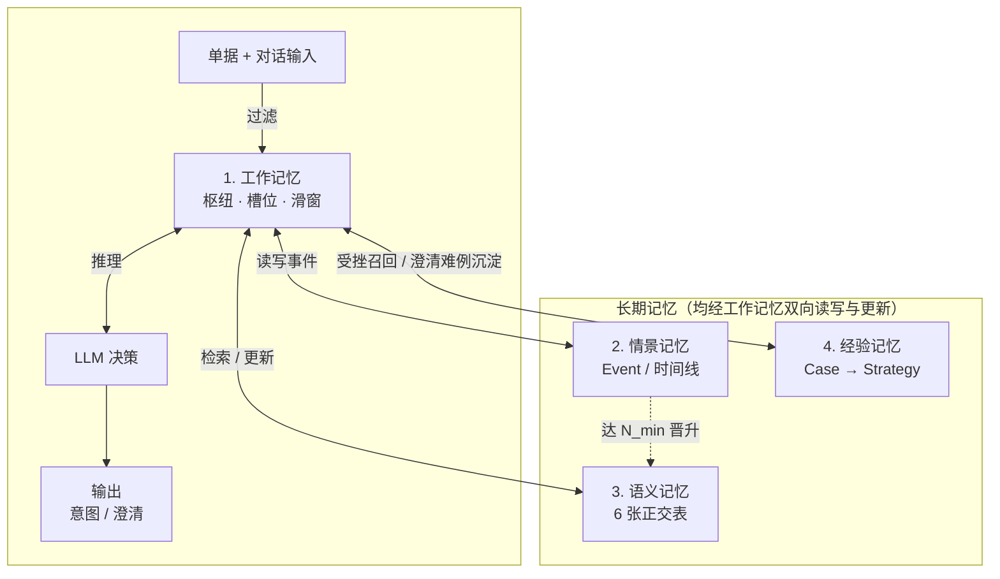
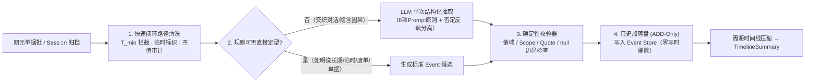
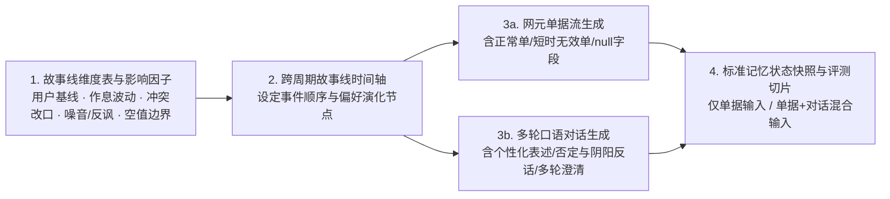
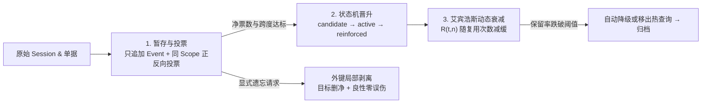

# 意图理解 Agent 记忆系统方案设计文档

<sub>以网络保障场景为例：面向网元单据流与多轮口语对话结合的意图理解 Agent，系统阐述记忆系统的总体设计取舍、存储拓扑与认知分层、**工作记忆 / 情景记忆 / 语义记忆**的构造与检索、**经验记忆（程序记忆）与 Benchmark** 的协同构造，以及巩固、晋升、衰减、淘汰与受控遗忘治理机制。</sub>

---

## 1. 总体定位与架构取舍

### 1.1 网络保障场景的四项刚性约束

在网络保障场景中，意图理解 Agent 的核心任务是在用户输入信息缺失或指代模糊（`Underspecified`）时，准确还原用户真实诉求，实现**“成熟习惯快速闭环，未知、冲突或高风险场景通过慢路径多轮澄清消除歧义并确认”**。网元单据与多轮对话结合对记忆系统提出三项刚性约束：

1. **两类信息源异构互补**：网元单据高频、隐式、数值精确，反映“用户实际上在何时何地用了什么业务、网络是否卡顿”；口语对话稀疏、显式、含主观意愿，反映“用户想要什么、为什么改口、有哪些个性化表达”。两者必须协同，但事实证据与主观偏好不能混存。
2. **数值零幻觉与空值拒答边界**：保障参数（时延上限、持续时长、分辨率）要求严格准确；原始单据天然存在未观测空值（`null`），记忆系统必须显式保留未观测边界，严禁推测回填。
3. **可审计演化与零误伤遗忘**：偏好会随出差、作息迁移而变化，旧规则退出时必须保留可追溯版本链；用户显式要求删除某段记忆时，必须做到“目标删净且良性习惯零误伤”。

### 1.2 三项关键工程取舍

1. **为什么不能完全直接迁移记忆框架（`Mem0ᵍ`、`MemoryOS` 与 `MIRIX-2.0` 的取舍）**：
   - **`Mem0ᵍ`（是否考虑使用图）**：`Mem0` 对比实验表明，引入图结构后整体准确率提升有限（单跳查询反而略降），但注入 Token 与检索延迟成倍增加，还带来额外的图数据库运维与实体关系抽取开销。
   - **`MemoryOS`（北邮）**：其三级分层与阈值晋升骨架很有启发，但写入链路需多次调用大模型，且热度机制容易把“单次会话多轮讨论”误判为“长期习惯”。
   - **`MIRIX-2.0`**：其“原始证据与上层索引分离”和“出处核验”思路值得借鉴，但原系统最初面向电脑屏幕截图等多模态桌面助手场景（结构复杂、分库较多），在只有文本对话与结构化单据的场景下直接迁移维护成本过高。
   - **取舍结论**：因此本方案考虑放弃知识图谱建图与重型多库底座，只吸收分级晋升、版本链与证据分离等轻量设计，直接在结构化记录中通过外键字段（`evidence_event_ids`、`supersedes_memory_id`、`timeline_summary_id`）实现低延迟、可审计的确定性关联。
2. **写入状态操作权衡：`ADD / UPDATE / DELETE` 理论模型与“只 `ADD`”工程实践的权衡**：
   - 多数论文（如 `Mem0` 论文版）在写入侧设计了 `ADD / UPDATE / DELETE / NOOP` 四操作，但代价是每轮写入必须执行**两次 LLM 调用**（第 1 次抽取事实，第 2 次召回 Top-10 邻近记忆让 LLM 判断增删改），且 `UPDATE / DELETE` 一旦误判会不可逆地破坏历史。
   - 正因如此，`mem0` 开源主线（`V3` 源码 `mem0/memory/main.py`）在实际工程中改为**写入侧只追加（`ADD-Only`）以减少一次 LLM 调用**，把所有相关记录都在检索时放回给模型判断。但纯 `ADD-Only` 在网络保障场景下会带来新问题：用户把默认分辨率从 `1080p` 改为 `720p` 后，新旧两条记录在检索时同时出现，直接干扰快速闭环槽位填充（尤其考虑到我们当前部署的模型并非强旗舰大模型，在多条新旧记录同时召回且用户未明确指代的情况下，容易判断失误或额外增加一轮澄清）。
   - **本方案采用“分层分治”策略（具体写入与冲突消解机制详见第 4.2～4.3 节）**：
     - **情景记忆（`Event` 层）坚持只追加（`ADD-Only`）**：每条网元单据和对话事件直接顺序记入流水账，不做写时删除或修改，省去一次大模型调用，也完整保留原始证据；
     - **语义记忆（`Preference` 层）按“唯一键查表更新”替代大模型冲突比对**：与开放域闲聊助手存储自由文本长句不同，**我们的业务是意图理解与槽位提取 Agent，提取出的意图、业务和保障参数天生是强结构化的**，因此才能按“用户 + 应用 + 业务 + 场景 + 参数名”存入固定格子里（例如 `USER_001 + 抖音 + 直播 + 分辨率`）。当新结论写入同一个格子时，程序直接比对新旧结构化值即可，**无需再调一次大模型去检索 Top-10 记忆判断冲突**：若新值与旧值相同（还是 `1080p`），支持次数 `+1`；若新值与旧值冲突（改口为 `720p`），则把旧记录标记为“已失效（`superseded`）”并记录失效时间，同时写入新版 `720p` 记录并关联旧记录编号。平时检索只取“当前有效”的记录，避免新旧并存干扰推理；需要追溯历史变化时，再一并查出旧版本。
3. **程序记忆（经验记忆）的语义边界拆分：底层源码只读，业务经验动态学习**：
   - 在经典 `CoALA` 架构中，“程序记忆（`Procedural Memory`）”最初指代 LLM 隐式权重以及智能体源码中的控制循环与工具代码，因此原文建议将其设为**只读（Read-Only）**以防智能体改坏自身程序。
   - 而在当前意图理解 Agent 语境下，**“程序记忆 / 经验记忆”的指代已分化为两层**：**底层框架代码**（主决策循环、工具注册、数据库校验器）仍保持严格只读；而**业务级经验策略**（如何减少澄清轮次、重大场馆提前预热提醒、多单冲突合并确认）则必须支持从多轮澄清成败轨迹中动态学习写入，并分为**软固化**（`ReasoningBank` 风格的结构化澄清经验条目 `Strategy`，受挫时按需注入提示词）与**硬固化**（逻辑完全固定的高频规则直接下沉为确定性 Python 校验函数，实现零 Token 拦截）。

---

## 2. 记忆准入边界与 User / Agent 空间隔离

系统遵循**“只保存未来会改变意图理解、槽位补全、追问决策或风险控制的内容”**原则，并在物理目录上严格隔离 **User 空间**（特定用户的事实与偏好）与 **Agent 空间**（跨用户可复用的网络保障经验策略）。

### 2.1 网元单据与对话的准入过滤边界

| 信息来源 | 应当记住的内容（准入长期化或证据化） | 严禁直接长期化的噪音与边界 |
| :--- | :--- | :--- |
| **网元单据流** | ① 达有效时长门限 $T_{\min}$ 的常规会话五元组（应用、子应用、基站、时段、时长）；<br/>② 周期性复现的时空规律（经时间窗 $W_{\text{span}}$ 内多次观测确认）；<br/>③ 连续出现卡顿异常的客观记录（作为经验归因依据）；<br/>④ 原始记录中的未观测字段清单（`unobserved_dims`）。 | ① 有效时长低于 $T_{\min}$ 的误触打开或中途取消的无效单据；<br/>② 时间窗内仅偶发 1 次、无跨日复现的孤立访问。 |
| **多轮对话流** | ① 个性化表述映射（如“腾会”指腾讯会议、“老样子”指常用配置）；<br/>② 明确长期声明（“以后默认……”）与跨会话一致确认；<br/>③ 场景覆写条件（如外勤现场、高铁途中）与特定网络环境取舍偏好；<br/>④ 显式改口纠错与支线退场声明。 | ① 无保障槽位的纯闲聊寒暄（询问天气、客服下班时间）；<br/>② 域外诉求（如宽带光纤报修、家庭路由器组网）；<br/>③ 已自愈无需干预的反馈；<br/>④ 明确标记“今天、这次、本次、临时”的一次性选择；<br/>⑤ 否定与反话（含阴阳语气）中被排除或情绪抱怨的字面靶点（如“不要 4K”、“卡成这样真是太流畅了”）。 |

### 2.2 四层记忆分工与空间隔离

参考 `BehaviorMem`“记忆池（Remember）与推断池（Infer）解耦”以及 `CoALA` 的空间隔离思想，除单次会话内临时承载交互上下文的**工作记忆（Working Memory）**外，进入长期存储的三类信息分别对应**情景记忆、语义记忆与经验记忆**三个层级，必须严格分开管理：

1. **客观网络事实 → 归入 User 空间 · 情景记忆层（`Episodic Memory` / `Event`）**：例如“当前处于弱覆盖移动中且上行丢包率高”，这是单次客观观测，不直接等于用户偏好。
2. **用户环境与场景偏好 → 归入 User 空间 · 语义记忆层（`Semantic Memory` / `Preference`）**：例如“弱覆盖移动时，用户宁可降低分辨率也要保语音不断流”。单次选择只生成 `Event`，仅当用户明确因果声明或在相似环境下重复一致达 $N_{\min}$ 次时，才巩固晋升为长期语义偏好。
3. **Agent 经验策略 → 归入 Agent 空间 · 经验记忆层（`Procedural Memory`）**：例如“当再次出现重大事件或大型场馆保障场景，且用户只提到活动开始时间、未考虑提前调试时间时，主动提醒用户将保障起始时间提前 $\Delta t_{\text{warmup}}$ 进行预热”。Agent 空间不存储某个用户的私人习惯，而是专门沉淀“**遇到某类状态应如何决策，才能更快闭环用户问题、减少无效澄清轮次并避免保障返工**”的通用动作策略。

### 2.3 User 与 Agent 空间隔离示例（网络保障场景）

历史会话中，`USER_001` 明确表示：“以后我说‘开播保障’，就是抖音户外直播。默认 1080P 并优先稳定，网络不好时可以降到 720P。”当前会话中，该用户只说：“今晚在景区给我开播保障。”

- **User 空间**保存该用户的私人信息：
  - `preferences/expression/`：“开播保障”映射为抖音户外直播；
  - `preferences/experience_parameter/`：默认 `1080P`、稳定优先，弱网时允许降到 `720P`；
  - `events/`：记录用户在哪个 `Session`、哪些 `Turn` 中声明并确认了这些内容；
  - `timelines/`：记录上述偏好何时形成、何时强化、是否出现过临时例外或纠错。
- **Agent 空间**不保存 `USER_001` 的具体偏好，只保存处理此类问题的通用澄清经验：
  - `raw_cases/`：当用户只说个性简称且附带户外场景时，如何通过“先展开表达映射 + 再结合场景确认参数”快速收敛的难例轨迹切片；
  - `strategies/`：经对比蒸馏沉淀的三段式澄清经验条目（`Title` + 适用/禁用边界 `Description` + 可迁移澄清策略 `Content`，如“命中高可信个性化表述且场景明确时，直接携带默认参数合并确认，不逐项反问”）。

---

## 3. 存储拓扑与四层正交认知分层

### 3.1 四层正交认知分层

四层记忆在存储与职责上**正交解耦、并列独立**，统一以**工作记忆**为唯一交互枢纽（三类长期记忆均通过工作记忆进行双向读取与更新）：在线交互或 Benchmark 仿真中，工作记忆按需从长期记忆召回子集并与大模型交互输出意图或澄清；单轮或会话结束后，再经工作记忆将客观事件写入**情景记忆**、将明确声明或状态变更更新至**语义记忆**、将多轮澄清难例轨迹沉淀至**经验记忆**；同时支持后台异步将高频重复的情景事件晋升为语义记忆（例如：用户连续多天在 `20:00–22:00` 打开抖音直播的网元单据，最初仅作为单次事件记入情景记忆；后台在时间窗 $W_{\text{span}}$ 内统计其复现达 $N_{\min}$ 次后，自动异步晋升为语义记忆“该时段默认业务为抖音直播”）。



> 交互式动图演示：[四层记忆架构与工作记忆枢纽交互动图](file:///D:/coding/sharing/.lavish/connectivity_agent_sub/memory_layer_architecture_anim.html)（支持分阶段动态流转演示与模块点击查看）

### 3.2 单一存储表达对比与三层无图组合存储

单一存储介质无法同时满足精确过滤、条件例外表达与分层加载需求：

| 单一表示 | 优点 | 主要问题 |
| :--- | :--- | :--- |
| **纯文本** | 表达能力强，适合 LLM 阅读 | 难以精确过滤、更新、判断有效期和并发控制 |
| **纯 JSON / 关系表** | 可校验、可查询、可审计 | 复杂条件、例外、原因和案例语义表达不足 |
| **纯向量** | 语义召回方便 | 不是权威事实存储，不能可靠处理冲突、替代和时间有效性 |
| **纯知识图谱** | 适合关系遍历 | 建图与更新 LLM 损耗高，正确率增益有限（`Mem0ᵍ` 仅 `+1.56` 分而延迟近翻倍） |
| **纯目录树** | 便于组织和分层加载 | 不能单独表达证据、冲突和版本演化 |

针对上述短板，并参考 `MIRIX-2.0`“原始证据与索引分离”与 `MemOS` 元数据血缘治理思想，系统采用**三层无图组合存储**（**向量与全文关键词索引均为派生索引，可全量重建，绝不作为权威状态**）：

1. **结构化节点与关系表**：保存 `memory_id`、`owner_id`、`scope`、`status`、双时间戳（`valid_at / invalid_at`）、`unobserved_dims` 及轻量外键（`evidence_event_ids`、`supersedes_memory_id`、`timeline_summary_id`）。
2. **Markdown 语义正文**：保存难以纯字段化的补充条件、例外说明与原因。
3. **OpenViking 目录树**：作为上下文组织骨架，负责 User/Agent 隔离、记忆类型分区与按需加载。

### 3.3 分层记忆在 OpenViking 目录拓扑中的映射与标准结构示例

OpenViking 目录树不仅隔离 `User` 与 `Agent` 空间，同时与四层记忆架构一一对应（工作记忆在会话期加载至运行时上下文，情景、语义与经验记忆分别落盘至对应目录）：

```text
viking://user/{user_id}/
├── profile.md                              # [综合画像] 由各类长期记忆综合汇总生成的用户画像概览
├── memories/
│   ├── preferences/                        # [语义记忆] 六张正交长期偏好
│   │   ├── expression/                     # 个性化表述映射
│   │   │   └── {memory_id}/
│   │   │       ├── memory.md
│   │   │       └── evidence.json
│   │   ├── service_to_app/                 # 应用↔业务默认路由
│   │   ├── periodic_preference/            # 周期时间路由
│   │   ├── preferred_value/                # 默认参数偏好
│   │   ├── scene_preference/               # 场景参数覆写
│   │   └── environment/                    # 特定网络环境偏好
│   └── events/                             # [情景记忆] 只追加原子 Event 流水与周期压缩摘要
│       ├── YYYY/MM/YYYYMMDD_HHMMSS_{event_id}.json
│       └── timelines/{topic}_summary.json
└── sessions/{session_id}/history/          # [工作记忆归档源] 会话期加载至工作记忆，结束归档

viking://agent/{agent_id}/
└── memories/                               # [经验记忆] 帮助用户快速闭环、减少澄清轮次的通用策略
    ├── raw_cases/                          # 多轮澄清难例轨迹切片
    └── strategies/                         # 三段式澄清经验条目（Title / 适用禁用边界 / 澄清策略）
```

各目录与四层记忆的对应职责如下：

| 目录 | 所属记忆层级 | 保存内容 | 主要作用 |
| :--- | :--- | :--- | :--- |
| `sessions/{session_id}/history/` *(及运行时滑窗)* | **工作记忆 (`Working`) → 会话归档** | 会话期活跃意图、待补槽位、召回切片；结束后归档原始会话与单据快照 | 承载单轮推理与长期记忆双向读写，保留审计来源 |
| `events/` *(含 `YYYY/MM/` 与 `timelines/`)* | **情景记忆 (`Episodic`)** | 只追加原子 `Event` 流水及按主题压缩的周期时间线摘要 | 记录“何时发生了什么”；周期压缩摘要用于快速回顾习惯形成、临时例外与改口变迁，避免追溯时逐条翻查海量零散事件 |
| `profile.md` | **综合画像视图** | 由语义偏好与长期交互综合汇总的用户画像概览 | 提供快速全局画像上下文 |
| `preferences/` & `evidence.json` | **语义记忆 (`Semantic`)** | 六类正交偏好（表述映射、应用业务路由、周期时段、默认参数、场景覆写、网络环境）及关联 `Event` 证据索引 | 支撑快速闭环、槽位补全与“为何形成该结论”溯源 |
| `raw_cases/` & `strategies/` | **经验记忆 (`Procedural`)** | 多轮澄清难例切片与 `ReasoningBank` 风格三段式澄清经验条目 | 在受挫门控下调整提问策略，帮助用户快速闭环并减少澄清轮次 |

**双源事实抽取原则与原子 `Event` 示例（多轮对话 + 网元单据）**：

- **A. 多轮对话事实抽取（参考 `Mem0` V3 `ADDITIVE_EXTRACTION_PROMPT` 八项 Prompt 原则）**：
  1. **语境完整，拒绝碎片化**：保留事件主体、行为与前后因果语境，避免抽成脱离上下文的孤立词片段；
  2. **精炼完整**：单条事件描述保持在完整清晰的 `1–2` 句内，既不丢失要素也不写成冗长散文；
  3. **细节溢出按主题拆条**：单轮对话包含多个独立保障主题时按主题拆成多条，不靠压缩丢失细节；
  4. **写入即消解指代，保持自足**：将“它”、“老时间”、“那个”消解为具体应用、业务或场景主体；
  5. **专名、日期与数值零丢失**：应用名、分辨率、时延上限与时间表达式等核心细节绝不为了精简而省略；
  6. **状态变化带“从什么变成什么”**：用户改口时同时记录新设定与被替代的旧状态；
  7. **多槽位关联不重复复制**：同一次原子表达涉及多个槽位时，只生成一个 `Event`，通过 `target_slots` 关联多个槽位；
  8. **存疑就抽，宁全勿漏（配合排除与时间锚定）**：对可能影响意图的表述优先抽出交由下游过滤，同时严格剔除纯寒暄、助手复述与无证据细节污染；所有相对时间均按 `event_time` 锚定为绝对日期或标准时间窗，并强制写入 `source_session_id` 与 `evidence_turns`。
- **B. 网元单据事实抽取（确定性结构化抽取，不调用 LLM）**：
  网元单据本身已是结构化记录，直接通过确定性规则管线抽取为 `Event`：先校验 `duration >= T_min` 过滤误触打开或中途取消的无效单据；再将应用、子应用、时段与时长直接映射为标准槽位与 `target_slots`；最后将单据中缺失或未上报的字段显式写入 `unobserved_dims`（严禁大模型推测回填）。

对话 `Event` 与网元单据 `Event` 同构示例如下：

```json
{
  "event_id": "EVENT_E1",
  "event_time": "2026-08-25T09:00:00Z",
  "source_channel": "dialogue",
  "event_type": "expression_mapping_confirmation",
  "source_session_id": "SESSION_S1",
  "evidence_turns": [1, 2, 3],
  "target_slots": ["application", "business", "scene"],
  "unobserved_dims": ["latency", "resolution"],
  "content": {
    "source_expression": "开播保障",
    "application": "douyin",
    "business": "live",
    "scene": "outdoor_live"
  }
}
```

```json
{
  "event_id": "EVENT_T102",
  "event_time": "2026-08-26T20:15:00Z",
  "source_channel": "ticket",
  "event_type": "network_session_record",
  "source_ticket_id": "TICKET_20260826_8841",
  "target_slots": ["application", "business", "time_window", "duration"],
  "unobserved_dims": ["scene", "resolution"],
  "content": {
    "application": "douyin",
    "business": "live",
    "time_window": "20:00-22:00",
    "duration_min": 95
  }
}
```

**结构化记忆节点（`Memory`）示例与版本演进说明**：

```json
{
  "memory_id": "MEM_PREF_001",
  "owner_type": "user",
  "owner_id": "USER_001",
  "memory_type": "preference",
  "sub_type": "experience_parameter",
  "scope": {
    "application": "douyin",
    "business": "live",
    "scene": "outdoor_live"
  },
  "slot": "resolution",
  "value": "1080p",
  "fallback_value": "720p",
  "unobserved_dims": [],
  "status": "reinforced",
  "supersedes_memory_id": null,
  "evidence_event_ids": ["EVENT_E1", "EVENT_E8"],
  "timeline_summary_id": "TL_PREF_001",
  "validity": {
    "valid_at": "2026-08-25T09:00:00Z",
    "invalid_at": null
  },
  "support_count": 3,
  "negative_count": 0,
  "version": 1,
  "last_reinforced_at": "2026-09-02T19:30:00Z"
}
```

以上述节点为例，不建图时仅靠外键字段即可完成完整追溯与版本替代：
- **证据溯源**：当需要解释“为什么默认给 `USER_001` 的抖音户外直播配 `1080p`”时，程序顺着 `evidence_event_ids` 直接定位 `EVENT_E1`（`SESSION_S1` 第 1–3 轮明确声明）与 `EVENT_E8`（后续复现确认），并可通过 `timeline_summary_id`（`TL_PREF_001`）读取该偏好的阶段摘要；
- **版本替代**：假设 9 月 10 日用户在会话中改口“最近流量紧张，户外直播以后默认改 `720p`”，系统生成新记录 `MEM_PREF_002`（`value: "720p"`、`version: 2`、`supersedes_memory_id: "MEM_PREF_001"`、`evidence_event_ids: ["EVENT_E12"]`），同时将 `MEM_PREF_001` 的 `status` 改为 `superseded` 并填入 `invalid_at`。日常检索只查 `status` 有效的 `MEM_PREF_002`，审计时顺着 `supersedes_memory_id` 即可还原完整变更链。

### 3.4 六张正交用户偏好表

| 正交表名 | 唯一键组合 | 唯一职责（Single Source of Truth） | 严禁混存的字段 |
| :--- | :--- | :--- | :--- |
| **1. 应用↔业务默认路由 (`service_to_app`)** | `user_id + business` *(双向索引)* | 保存业务与应用的默认绑定，解决“只提业务补应用”或“只提应用补业务” | 画质/时延参数、周期时段、场景 |
| **2. 周期时间路由 (`periodic_preference`)** | `user_id + time_window + app:biz` | 保存时段到业务的映射（如 `08:00-09:00 → tencentmeeting:meeting`） | 具体 QoS 数值参数 |
| **3. 默认参数偏好 (`preferred_value`)** | `user_id + application + business` | 保存该应用与业务下的标准体验参数（分辨率、时延上限、优先级） | 周期时段、特定物理场景 |
| **4. 场景参数覆写 (`scene_preference`)** | `user_id + scene + application + business` | 仅在特定物理/任务场景（如外勤现场、高铁车厢）下覆写体验参数 | 周期时段 |
| **5. 个性化表述映射 (`expression`)** | `user_id + alias` *(含适用 scope)* | 将用户口语代称（“腾会”、“460”）翻译为标准槽位值，检索前先行展开 | 母记忆参数快照 |
| **6. 网络环境偏好 (`environment`)** | `user_id + env_condition + app + biz` | 弱覆盖、高拥塞等特定网络环境下的参数退让策略（如保语音降画质） | 常规时段与非环境偏好 |

---

## 4. 四类记忆构造与分层 Benchmark 设计

本章分别阐述工作记忆、情景记忆、语义记忆与经验记忆的构造机制，以及对应的分层 Benchmark 评测设计。

### 4.1 工作记忆（Working Memory）的构造与 Benchmark 设计

1. **构造机制（会话期临时枢纽）**：
   - **构成要素**：① **当前活跃意图与槽位状态表**（已明确槽位、待补全槽位与待确认假设槽位）；② **近期对话滑窗**（剔除已处理的寒暄与无效重试）；③ **按需加载的检索切片**（仅注入本轮命中当前 `Scope` 的语义记忆子集，以及受挫门控触发的 Top-$1$ 经验规则）。
   - **生命周期**：随 `Session` 建立而初始化，每轮更新槽位状态；会话结束即销毁，原始交互与单据结果经工作记忆写回长期记忆。
2. **工作记忆 Benchmark 构造**：
   - **评测切片**：构造多轮上下文渐进补全、跨轮指代消解与高并发长历史注入干扰样本，验证工作记忆能否在不塞入全量历史的前提下准确追踪待补槽位、避免冗余追问或遗漏当前轮改口。

### 4.2 情景记忆（Episodic Memory）的构造与 Benchmark 设计

1. **构造机制（`ADD-Only` 只追加 + 规则前置拦截 + 单次抽取）**：



   - **快速闭环路径（规则拦截噪音，零 LLM 成本）**：

| 规则类别 | 触发特征 / 条件 | 确定性动作 |
| :--- | :--- | :--- |
| **短时无效单据拦截** | 网元单据 `duration < T_min` 或中途取消标记 | 直接拦截记录审计日志，不进入 `Event` 与长期记忆 |
| **临时单次选择识别** | 出现“今天、这次、本次、临时、先这样” | 强制标为 `temporary_choice`，仅存情景流水，禁止晋升长期偏好 |
| **长期规则信号识别** | 出现“以后、默认、每次、都按这个、以后我说 X 就是 Y” | 标记高权重长期候选，保留提取出的明确参数 |
| **时间与词表标准化** | 自然语言时间词、APP 别名、分辨率/时延单位 | 确定性转换为标准时间区间与固定槽位枚举值 |
| **未观测维度审计** | 网元单据字段缺失或未上报 | 显式写入 `unobserved_dims`，禁止后续推测补全 |

   - **大模型单次结构化抽取与时间线压缩**：仅当对话存在多轮交织、否定子句或阴阳反话（如“不要 4K，720p 流畅就行”、“这网速真是快到起飞了”）时触发单次 LLM 抽取；同一用户同主题积累一定 `Event` 后压缩为 `TimelineSummary`，并通过 `timeline_summary_id` 双向追溯。
2. **情景记忆 Benchmark 构造**：
   - **评测切片**：在故事线中刻意混入 `duration < T_min` 的误触单据、纯闲聊、临时一次性声明与阴阳反话对话，检验 `Event` 抽取准确率、噪音拦截率与相对时间锚定准确度。

### 4.3 语义记忆（Semantic Memory）的构造、检索与 Benchmark 设计

1. **构造与“分层分治”确定性更新（接续第 1.2 节）**：
   - **跨周期聚合晋升**：同一 `(user_id, scope, slot)` 在时间窗 $W_{\text{span}}$ 内重复出现达 $N_{\min}$ 次（或经用户显式长期声明），才由 `Event` 晋升为语义记忆；
   - **主键级确定性合并（替代第二次 LLM 冲突比对）**：依托六张正交表主键精确定位格子。同值则 `UPDATE`（支持度 `+1`、刷新 `last_reinforced_at`）；异值（用户改口）则 `SUPERSEDE`（写入新版并将 `supersedes_memory_id` 指向旧版，旧版标为 `superseded` 并记录 `invalid_at`），日常检索仅取有效版本。
2. **四步多路混合检索机制**：
   `MERIT` 实证显示，纯向量检索在更新事实任务上的跨随机种子方差高达 `0.45`、更新忽略率达 `0.45`；`A-MEM` 也暴露了陈旧嵌入失效问题。因此检索执行四步协同：
   - **Step 1 个性化表述展开与时间解析**：扫描有效 `expression` 表，将“腾会”、“460”翻译为标准槽位与 KQI 目标，并解析自然语言时间表达式；
   - **Step 2 指针两跳与同行结构化槽位提取（Row-Level Column Projection）**：通过 `periodic_preference` 与 `service_to_app` 完成时间/应用/业务互相补全；向量或全文检索（FTS5）命中候选后，**直接读取同一结构化记录行中的精确数值列**，不依赖切片文本匹配；
   - **Step 3 时效与空值边界过滤**：默认过滤 `status == "superseded"` 或不在 `[valid_at, invalid_at]` 区间内的记录；若提问涉及 `unobserved_dims` 标记为 `null` 的维度，返回 `UNOBSERVED` 边界标记触发诚实拒答；
   - **Step 4 多维融合重排**：结构化精确命中赋予高基准分，结合向量相似度、关键词分与艾宾浩斯保留率 $R(t, n)$ 输出最终排序。
3. **语义记忆 Benchmark 构造**：
   - **评测切片**：构造偏好中途改口覆盖（检验 `SUPERSEDE` 与防旧值复活）、个性化表述多义映射、“仅单据输入 vs. 单据+对话混合输入”下的槽位补全，以及针对 `null` 未观测字段的拒答探针，对照标准记忆状态快照（Ground Truth）评估准确率与幻觉回填率。

### 4.4 经验记忆（Procedural Memory）的构造与多轮澄清 Benchmark 设计

在网络保障场景中，**经验记忆解决的不是“用户常用什么”，而是“在信息缺失、指代模糊或存在冲突的多轮澄清交互中，Agent 该采取什么提问与确认策略才能更快 get 到用户真实想法、减少澄清轮次并避免误判”**（当前阶段聚焦意图提取与多轮澄清难题，不涉及下游网络工具执行报错）。经验规则直接来源于 Benchmark 中的“历史单据记录 + 多轮澄清交互轨迹 + 收敛结果”，并在同一 Benchmark 中检验其能否**显著减少无效澄清轮数、避免冗余追问或未澄清直接输出错误意图**（不能只看文本相似度或最终意图提取准确率）。

1. **基于多轮澄清难例的构造与对比蒸馏（`Reflexion` + `SPEM` + `ReasoningBank` + `WASP-Mem`）**：

| 结构层级 | 核心存储字段 | 构造来源与作用 |
| :--- | :--- | :--- |
| **`Case` 难例切片 (`raw_cases/`)** | 初始缺失/模糊点、用户口语表达、Agent 澄清提问序列、用户反馈/改口、最终收敛轮次与成败归因 | 从工作记忆沉淀的多轮澄清日志中剔除无关寒暄，保留“1～2 轮快速收敛”与“反复追问仍未懂用户意图”的成败对比轨迹 |
| **`Strategy` 经验条目 (`strategies/`)** | ① **`Title`**：核心澄清模式短标题；<br/>② **`Description`**：一句话明确 **`when or when NOT to use`**（`applicable_condition` 适用条件与 `exclusion_boundary` 禁用边界）；<br/>③ **`Content`**：1～3 句可迁移澄清提问策略与防误判护栏；<br/>④ **来源 `Case` 片段核验** | 剥离 `user_id` 与私人参数，沉淀“遇到哪类模糊输入怎么一问收敛”的通用澄清策略 |

   - **`Reflexion`（单次会话内的即时纠偏与防假阳性边界）**：在单次多轮澄清过程中，若 Agent 某轮追问被用户否定或偏离诉求，先利用局部反思滑窗（仅限本会话内纠偏）指出遗漏的关键澄清维度并调整下一轮提问；同时吸取 `Reflexion` 自测 `16.3%` 假阳性警示，绝不凭模型主观自评“已经听懂”就提前输出，必须经过确定性槽位完备度检查与用户确认。
   - **`SPEM`（长轨迹反向切片提纯与失败负保护）**：多轮澄清轨迹常夹杂试探性无效反问与中途改口分支（`SPEM` 消融显示原样存入冗余轨迹会掉点 `7.7%`）。入库前以**“最终准确收敛意图”为终点执行因果反向切片（Backward Slicing）**，剪掉对收敛无贡献的冗余追问步，折叠提纯出“初始模糊点 → 关键澄清一问 → 收敛意图”的紧凑骨架（`SPEM` 平均砍掉 `54.9%` 冗余步）；同时对未成功收敛的失败轨迹实施**失败负保护**——严禁直接生成新策略模板，仅扣减本局所引策略的可靠性分。
   - **`ReasoningBank`（跨任务正反双通道蒸馏与 `MaTTS` 自对比）**：不仅从快速闭环的成功轨迹提炼正例（`SUCCESSFUL_SI`），更重点从“多轮无效反问、抓不住重点或未提醒前置条件”的失败轨迹定位根因（`FAILED_SI`）；对同类模糊输入并行采样成功与失败轨迹做**跨轨迹自对比（Self-Contrast）**，一次性提炼高泛化澄清策略（例如：大型场馆活动用户只提开始时间时，在合并确认中顺带提醒提前预热 $\Delta t_{\text{warmup}}$，一轮即可收敛），并配合 `MIRIX-2.0` 原话片段核验防幻觉。
   - **`WASP-Mem Free Form`（先读后写隐式归并，解决只追加膨胀）**：`ReasoningBank` 原版只追加写入会导致上千任务后堆积大量冗余与矛盾条目；而 `WASP-Mem` 实证显示，用脚本按动作名强合并（`Schema Form-ED`）又会引发跨场景误合并并膨胀至 `789~838 KB`（准确率仅 `65.7%~67.0%`）。因此系统采用 **`Free Form` 先读后写归并**（`233~255 KB`、准确率 `72.3%~72.5%`）：写入新经验前先按场景与意图目录读取相似旧条目，再决定“在原条目上增补澄清分支”还是“新建独立条目”。

2. **运行态受挫门控、召回限流与单次曝光驱逐**：
   - **受挫门控与 Top-$1$ 限流（`Struggle Gate`）**：经验记忆**禁止在常规快速闭环中默认全量注入**。仅当出现多轮澄清仍未收敛、用户连续否定确认建议或存在多条冲突表达时，才触发经验库召回——且**每次严格限流注入 Top-$1$（至多 `2~3` 条）**，并在推理前显式核验 `applicable_condition` 且未触发 `exclusion_boundary`；
   - **单次曝光驱逐（`One-Shot Eviction`）与胜率重评**：经验策略被注入后，系统追踪本次会话的澄清轮次与用户确认反馈。若某条策略曝光后未能缩短澄清轮次甚至引发用户再次否定或误解，立即触发单次曝光驱逐或降权；每积累 $K_{\text{review}}$ 条关联 `Case` 触发一次条目重评，阻断错误经验自举。

### 4.5 后端故事线数据构造管线与联合评测指标

作为支撑四类记忆构造与经验蒸馏的**后端数据构造管线**，Benchmark 基于前期已定义好的**故事线维度表与影响因子**，采用“维度表约束 → 故事线时间轴生成 → 双源数据渲染 → 评测切片导出”流程构造高拟真数据集：



- **数据覆盖维度**：涵盖“**仅单据输入**”与“**单据 + 对话混合输入**”两类模式，覆盖常规习惯复现、口语个性化表达、突发冲突改口、短时无效单据干扰、特定网络环境退让与显式遗忘请求六类核心切片。
- **联合评测指标（有效性指标 + 安全红线）**：
  - **有效性指标**：历史相关意图补全准确率、任务平均澄清轮数与耗时、冗余追问率与未澄清直接执行率、检索与推理 Token 开销、经验策略注入后的澄清轮次缩减率；
  - **安全与治理红线**：
    1. **错误长期化率**：短时无效单据或临时一次性选择被误晋升为长期偏好的比例；
    2. **未观测维度幻觉回填率**：`unobserved_dims` 中标记为 `null` 的字段被大模型擅自推测补全的比例；
    3. **双约束遗忘指标**：显式遗忘后的目标信息残余率（目标为 `0`）与无关良性习惯连带误伤率。

---

## 5. 记忆生命周期管理：状态机晋升、时间衰减与受控遗忘

由于语义记忆存储在主键明确的正交表内，规模天然可控，系统**不堆叠复杂的多权重综合打分淘汰公式，而是只选用最契合结构化意图系统的“投票状态机 + 艾宾浩斯时间衰减”作为主治理机制**，并结合 `BEMULA`（显式遗忘成功率 $\le 1.5\%$）与 `MemSecBench`（暴力重编摘要导致 $30.2\text{ pp}$ 良性记忆误伤）的警示守住受控遗忘底线：



### 5.1 投票驱动的三级状态机晋升

单次隐式观测先落入 `Event` 暂存，经**时间窗 $W_{\text{span}}$ 内的跨会话聚合**与**带 `Scope` 守卫的正反向投票**完成晋升（在 `tencentmeeting` 下的否定不得错误扣减 `douyin` 下的偏好票数）：

| 投票类型 | 触发来源 | 治理影响 |
| :--- | :--- | :--- |
| **正向投票** | 用户明确长期声明（高权重）、确认 Agent 总结、跨会话同 `Scope` 一致复现、成功复用且无纠正 | 增加 `support_count` 与复用次数 $n$，提升至 `active` 或 `reinforced` |
| **反向投票** | 用户明确改口纠错（高优先级负票）、澄清确认建议被反复否定 | 扣减有效支持度，阻断晋升；达到冲突条件时触发 `SUPERSEDE` |

- **三级晋升状态机**：`candidate`（单次观察，不可用于快速闭环）→ `active`（累计支持度达 $N_{\min}$ 或显式确认，可参与检索与确认）→ `reinforced`（多次强化验证，支持快速闭环）。

### 5.2 带复习稳定性的艾宾浩斯动态衰减与归档

记忆保留率 $R(t, n) \in (0, 1]$ 随未复现天数 $\Delta t_{\text{days}}$ 指数衰减，并受累计正向强化次数 $n$ 调节，统一负责记忆的新鲜度排序、自动降级与超期归档：

$$
R(t, n) = \exp\!\left(-\frac{\lambda_0}{1 + \kappa \cdot \ln(1 + n)} \cdot \Delta t_{\text{days}}\right)
$$

符号解释如下：
1. $\lambda_0$：基础衰减率（`expression` 个性化表述词典设为 $0$ 不自动衰减；`preferred_value` 与 `service_to_app` 较低；`environment` 略高）。
2. $\kappa$：复习稳定性增益系数。
3. $\Delta t_{\text{days}}$：距离最近一次有效强化或成功复用的天数。

**状态自动退化与归档规则**：

| 当前状态 | 触发条件 | 目标状态 | 处理效果 |
| :--- | :--- | :--- | :--- |
| `candidate` | $R(t, n)$ 跌破观察阈值且长期未复现 | `expired` | 停止参与候选观察，避免偶发噪音长期占位 |
| `reinforced` | 极长周期未使用，保留率下降 | `active` | 降级为普通活跃状态，不再免确认快速闭环 |
| `active` | 超长周期未激活且 $R(t, n) < \tau_{\text{archive}}$ | `archived` | 移出热查询进入归档区（不物理删库，保留审计可查） |

### 5.3 常态软失效与显式遗忘的双约束治理

- **常态偏好迁移走软失效（`SUPERSEDE`）**：旧记录标为 `superseded` 并写入 `invalid_at`，新版通过 `supersedes_memory_id` 关联旧版，保留完整演化历史。
- **用户显式遗忘走外键局部剥离**：当用户要求“忘掉我以前在某某写字楼的习惯”时，系统绝不重写整段摘要，而是直接依据结构化 `evidence_event_ids` 与 `timeline_summary_id` 外键精准定位目标 `Event`、关联槽位及受影响的时间线摘要，执行定向删除与局部增量重算，确保**目标信息残余率为 0** 且**无关良性习惯零误伤**。

---

## 6. 窗口参数体系与来源治理

所有窗口与衰减参数统一纳入配置表管理，并强制标注来源标签（`paper_default`、`repository_default`、`business_default`、`experiment_tuned`），严禁硬编码拍脑袋阈值：

| 参数类别 | 核心参数符号 | 作用说明 | 典型来源标签 |
| :--- | :--- | :--- | :--- |
| **网元单据过滤窗** | $T_{\min}$ | 过滤误触打开或中途取消的无效短时单据 | `business_default` / `experiment_tuned` |
| **习惯聚合观察窗** | $W_{\text{span}}$ | 统计跨会话、跨日复现次数的滑动时间窗 | `business_default` |
| **晋升确认次数门限** | $N_{\min}$ | 隐式行为从 `candidate` 晋升至 `active` 所需的最小支持度 | `paper_default` / `experiment_tuned` |
| **预热与检索对齐窗** | $\Delta t_{\text{warmup}}$ | 周期时间路由与提前预热提醒的时间对齐裕度 | `business_default` |
| **艾宾浩斯衰减基数** | $\lambda_0, \kappa$ | 控制不同子类型记忆的自然遗忘斜率与复习稳定性增益 | `paper_default` / `experiment_tuned` |
| **经验重评与归档窗** | $K_{\text{review}}, \tau_{\text{archive}}$ | 积累关联 `Case` 触发经验条目重评及超期 `active` 归档阈值 | `experiment_tuned` |
